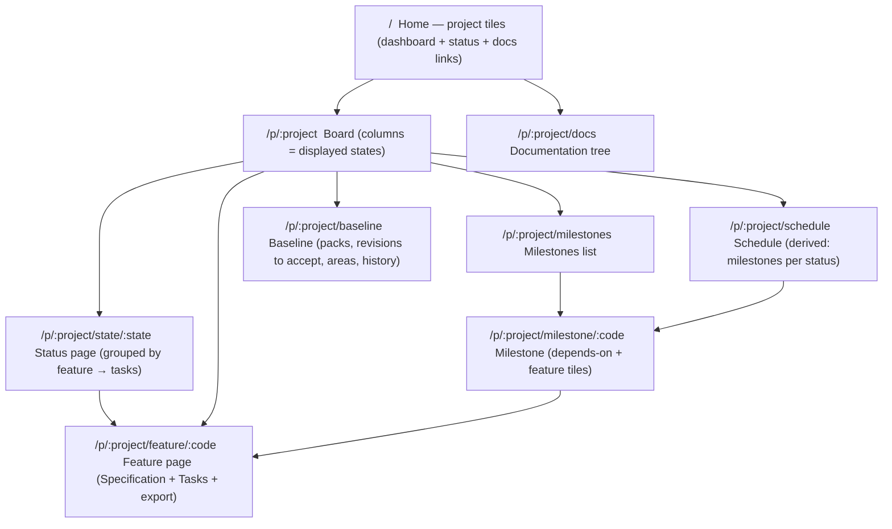

# The monitor's navigation map

## Web navigation map

## The meta route

`GET /api/meta` answers what the daemon can do (`writes`, `identity`, `schema_version`) and which
kanbanr it is: `version` and `commit` of the running build, `board_writer` (the record in the
board's `writer.yaml`, or null) and `writer_newer`, true when that writer is newer than the
running build (a higher version, or the same version with a commit that descends from the running
one in the code repository). The page header shows the build and, when `writer_newer`, a warning
(FTR-036). Every board write stamps `writer.yaml` in its own commit; the monitor never does.
