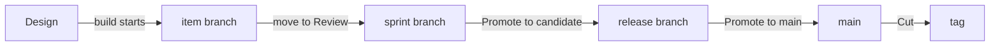

# Agile, sprints and releases with your agent

This guide takes a project from setup to a shipped release using the `agile` process, with sprints and
releases. You don't need to learn any commands:

- **You talk to your agent** for everything except decisions and pushes. Use your own words. The ones
  here are only examples.
- **You decide on the monitor:** approvals and sign-offs on the **Review** page, promotions and the
  cut on the **Releases** page.
  The agent tells you what is waiting there and links to it. It never records a decision, and it
  doesn't ask for one in a plan or a question. What the agent already knows, such as a CI run's
  result or what a sign-off covered, arrives filled in beside the button: you check it and click.
- **You can delegate the small decisions.** Tell your agent which ones it may take, such as the design
  review of small defects, and until when. Setup proposes two, for the agent to take the
  **design-review** of small defects and chores and the **docs-folded** sign-off of every item,
  besides any the agent proposes when you ask. You **Grant** each one on the **Review** page, under
  "Decisions here". A granted delegation does nothing until you set **Mode** to **delegated** there
  and click **Change**. Whatever the agent decides under it comes back there for you to keep or undo.
  If Claude Code runs in auto mode, its safety check may stop a delegated command. When you grant a
  delegation, Kanbanr offers the one allow rule that lets it through; say yes to the agent, or run the
  command it names.
  In **conversation** mode you take these in the agent's question dialog instead: it asks with the
  board's own question, and your answer is the record.
- **You push from your terminal.** Nothing reaches your remote server until you do.

Prefer to run the commands yourself? See [Agile from the command line](agile-cli.md). For the other
processes, see the [guides index](index.md) and [Processes](../using/processes.md).

## Three clocks

Three things move at their own pace:

| | What it answers | Moves when |
|---|---|---|
| **Stage** | How far has this item got? | Its gates are met, one item at a time |
| **Sprint** | What are we working on these two weeks? | You ask your agent to start or close it |
| **Release** | What has reached users? | You promote it on the Releases page |

An item can be merged into its sprint and still not released. **An item is released only when a
release that holds it is cut.**

## Setting it up

> Start using kanbanr for this project. Use the agile process.

The agent asks where the board should live and what the project is for, then writes a plan. **Accepting
the plan applies it.** The agile process turns sprints and releases on by default, and the agent also
turns on the git model, so branches are made for you.

> Agree a charter with me first, then set up release stages so that main has to be pushed before
> anything is tagged. Use only candidate, main and production.

Every item links to a goal in the charter. The recommended release stages are candidate, main and
production. Production, the cut, is refused until main is pushed.

**Accept the system baseline before the first build.** Once the system docs are written, the agent prepares the baseline and you accept it in the System baseline group on the Review page; until you do, the first item waits. The agent never accepts it for you ([The system baseline](../using/living-docs.md#the-system-baseline)).

> Open the monitor, with writes on.

Keep it open. Every decision below happens there.

## Planning a sprint

> Start a two-week sprint for the saved basket. Put it in, for release 1.0.

Setup doesn't create a sprint or a release, so the agent asks the sprint's goal and first day, and the
release's version and target, when you first ask. Then it creates the sprint and its branch, adds the item and plans it into the sprint and the release.
Your checkout doesn't move. A sprint and a release don't have to line up: one release can take items
from several sprints.

The agent recommends starting today. Work past the first stage waits until the sprint has started; a sprint dated later reads as planned until its first day.

## One item, stage by stage

> A shopper opens their basket on our shop's web page, leaves, and comes back the next day to find what they chose still there. Take it to Design.

**The agent asks whether it has a user interface.** When you choose the technology (or, if you don't,
when the first item is designed), the agent asks whether the product has screens a person uses, or is
a service, library or command-line tool. If it has screens, they become items of their own,
designed and approved like the rest. If it has none, that goes into the design, so a missing screen
is a decision and not an oversight. If it has screens, the agent also asks how the screens should look, the styling approach and the feel you want, before it designs the first one, and the answer goes into the design.

| Stage | What the agent does | What you do on the Review page |
|---|---|---|
| **Plan** | Writes what it is and why | Nothing |
| **Design** | Drafts the definition: statement, goals and requirements | **Approve** |
| **Develop** | Writes the design and its task list, names a test for each requirement, and starts the item's branch | **Sign off design-review** |
| **Test** | Builds on the item's branch and commits | Nothing |
| **Review** | Records the green tests and updates the docs | **Sign off docs-folded**, once every requirement has a green test |
| **Released** | Nothing: the cut moves it here | Nothing |

**Approve first, then sign off.** An item with both waiting shows **Approve**, then **Sign off** once
you've approved it, so check back after approving.

**A judgement check never holds an item.** When only a person can judge a requirement, the agent
writes it as the item's one judgement test. You are asked it at the release's cut, among the
requirements you accept untested, or when you see the thing in a walkthrough; click **Passed** under
**Manual checks** on the Review page when you have judged it.

**The agent's overrides come to you.** If the agent moves an item past a gate, it says why and the move
waits on the Review page with that reason, even on an item you approved. **Ratify** it there; until
you do, the item doesn't ship.

**Each approval covers the text you saw.** Adding to the definition keeps the approval, and what was
added is reviewed at the next decision. Changing or removing approved text lapses it, and the item
returns to the Review page.

**Moving to Review is the merge.** kanbanr merges the item's branch into the sprint's branch. It isn't
released yet.

**Agile asks for no release sign-off.** In this process a release only needs every item to have
reached Review, so there is no per-item sign-off at the release.

If something is missing for a move, the agent tells you what and either fixes it or asks you. Nothing
moves past a gate unless you say why, and that reason stays on the item.

### Chores

A chore doesn't walk every stage. It goes Plan → Develop → Test → Review → Released, skipping
Design, because its questions don't fit small maintenance work. Review is still where its branch
merges into the sprint, so it waits for **Sign off docs-folded** there like any item. Tell your agent
it's a chore when you ask for it.

> Pin the CI image: it's a chore.

Before its first move the agent asks once for what every item records: a one-sentence statement, the goal
it serves, and a requirement in the EARS form that says how it's verified. You still approve it before work starts. A chore has no Design section and no **design-review**. If
you change an item's kind to a chore while it's at a stage the chore path leaves out, it's off
the path: it moves by the ordinary moves, or back to Plan.

## When an item is done for a sprint

The agile process marks no stage as done other than **Released**. The sprint we followed was closed
after the cut, and nothing carried over. If your sprints end before your releases do, ask your agent
whether to count Review as done for a sprint. I did not see a sprint closed before its release in this
process.

## Feedback on a release

Feedback arrives as new items that name the version they were found in:

> Customers found a problem in v1.0.0 with the saved basket. Add it as an item found in v1.0.0.

A defect in a shipped release needs its own fix. See
[Patch releases](../using/processes.md#patch-releases).

## Handing work to sub-agents

> Have a sub-agent build these tasks.

The agent gives each sub-agent a scope, which Kanbanr enforces. An agent can record its own tasks and tests
and commit on its own branch. It can't move items, approve anything or push. You'll see its progress on
the item's page, and its scope on the **Workflow** page.

The agent stays in the project folder while a sub-agent works, and looks inside the agent's worktree
without moving into it (`git -C`), so a scope never gets in your way or the agent's. Revoking an agent's
scope stops that agent on its next tool call and never restricts you.

## Releasing

**Before your first release, design the pipeline.** A release workflow can only be tested by running
it, a tag can't be moved once it's pushed, and shipped notes can't be edited, so a mistake in the
pipeline costs a whole version number. Settle the stages, the checks, the release description and a run without a tag first:
see [Designing CI and the release workflow](delivery-pipeline.md). The agent proposes it when you plan the
first release, if setup recorded CI, and proposes the release files (notes, changelog, version files)
at the same time, before it names Promote to candidate.

| Step | Who | Do this |
|---|---|---|
| 1 | You | **Releases** page: **Promote to candidate**. This makes the release branch and drafts the version, changelog and notes |
| 2 | The agent | Say "Write the release notes and the changelog for readers", because the draft only lists requirements |
| 3 | You | Open **Release notes** on the release, then **Edit notes** and **Save** for any changes |
| 4 | The agent | Say "Run the full checks over the release" |
| 5 | You | **Releases** page: **Promote to main**. This moves main to the release, without tagging |
| 6 | You | Terminal: `git push origin main`. This is the first push the release needs |
| 7 | You | Wait for CI on main to go green |
| 8 | The agent, then you | The agent reads the run and prepares the result. **Releases** page: check the run's link and click **Record ci passed** |
| 9 | You | **Check again**, then **Cut v1.0.0**. This tags main and moves the items to Released, unless your stages continue after the tag: then **Confirm** each later stage, and the last one moves the items. The Cut stays greyed out until step 8 is done for the commit main is at. If some shipping requirements still have tests not run, the page lists them with one checkbox: tick it to ship them unverified, and the notes name them |
| 10 | You | Terminal: `git push origin v1.0.0` |
| 11 | The agent | Brings the release forward into the sprint and tells you; you push the sprint branch when you push |

**When to push.** You push twice for a release: main after **Promote to main**, and the tag after the **Cut**. Nothing earlier is needed: every check before that runs on your machine. If you want to see the pipeline run sooner, you can push the sprint's branch; that run is a preview and records nothing for the release. Recording CI, promoting and the cut are never delegated: even when you have let the agent take some forward decisions, these stay your clicks. If an item has moved back to an earlier stage, the agent asks you before it acts on it, delegation or not.

**Recording CI.** The Cut waits for a CI result recorded for the exact commit main is at. Kanbanr never asks your CI service. The agent reads the CI result and prepares it with the link to the run. You check it and confirm it with one click; you can edit it or reject it instead. A failed run is recorded as failed, and the page then says what to fix. After the Cut the release reads as tagged, not shipped, until the result of the workflow the tag started is recorded as passed; confirming that result ships it. A failed result keeps it tagged, and the page names the patch release as the way on.

**Each button says what it will do**, and stays greyed out with the reason until it's ready.

**Freeze the candidate.** Once a release is a candidate, send anything new to the next release and
change only the notes.

**Promoting moves main, not your checkout.** Your remote server won't change until you push.

**The date follows the release.** Promoting to main dates the notes and changelog today. If main moved
earlier and the cut comes later, the page warns you: ask your agent to re-date them before you cut,
because shipped notes can't be edited.

**A fix made during the release reaches the sprint the same way:** the agent brings it forward.

A patch release starts at **candidate** the moment it is created, so there is no first stage to promote from. The agent asks you in the conversation to confirm it; main and the tag are then decided on the Releases page as usual.

## Closing the sprint

> Close the sprint and do a retro.

The agent closes it and writes the retro with you. This changes only the board. Start the next sprint
before starting new items, because new items branch from the running sprint.

After the cut, the agent checks for leftovers with `kanbanr git tidy`. If merged item branches and
finished agents' branches can go, it asks you once, in a dialog, to delete them all, then deletes
them locally with the confirmation. Nothing unmerged is touched and the remote is left to you.
Each deleted branch's tip is reported, so one can be restored.

## Who does what

| | You | The agent |
|---|---|---|
| **Definitions** | Answer what only you know, then **Approve** | Draft them and keep the spec current |
| **Design** | **Sign off design-review** | Write the design and its task list |
| **Code and tests** | Review what you want to | Build, or give the work to sub-agents, and record results |
| **Merging an item** | **Sign off docs-folded** | Update the docs and move the item |
| **Sprints** | Say what goes in and when it closes | Create, plan and close them |
| **Releases** | Each **Promote** and the **Cut** | Write the notes, run the checks, bring it forward |
| **Remote server** | **Every push** of code and tags, and the board | Nothing |

## What the agent runs

You never need these. [Agile from the command line](agile-cli.md) covers them step by step.

| You asked for | The agent runs |
|---|---|
| Set up the process | `kanbanr config workflow --preset agile`, `kanbanr config cadence` |
| A sprint | `kanbanr sprint add`, `kanbanr sprint start`, `kanbanr sprint plan`, `kanbanr sprint unplan` |
| A release | `kanbanr release add`, `kanbanr release plan` |
| Moving an item | `kanbanr move` |
| Starting the build | `kanbanr start` |
| Release notes | `kanbanr release notes` |
| Bringing a release forward | `kanbanr git forward` |
| Closing a sprint | `kanbanr sprint close`, `kanbanr retro` |

To take an item out of the sprint, ask your agent to take it out; it goes back to no sprint.
