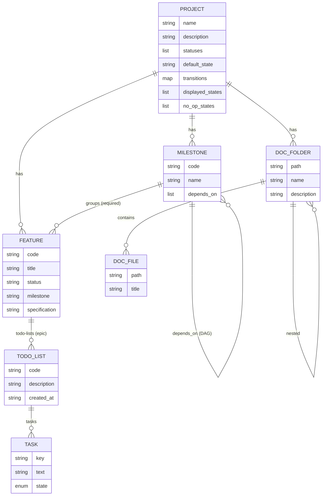

# The data model

## Data model

- **Status** is a configurable label; **transitions** is a map `from → [allowed to]`;
  `displayed_states` is the ordered subset the dashboard shows; `default_state` is the status a
  new feature starts in. **`no_op_states`** flags statuses that are inert dispositions (e.g.
  "No Action", "Not Applicable", "Out-of-Scope"): always non-displayed (kept disjoint from
  `displayed_states`), and a feature in a no-op state does **not** auto-advance to Completed.
- **Permanence / referential integrity:** feature items are **never deletable** (the work is
  permanent). A milestone can be deleted only when unreferenced; a status removed only when no
  feature is in it; a project deleted only when it has no features and no milestones — so any
  project with work is locked from deletion.
- A feature's **milestone is required**. A feature acts as an **epic**: it holds many persistent
  **todo-lists** (one added per work session), each with its own tasks (keys unique per list).
  `TASK.state` is `NotStarted | InProgress | Completed`; when every task across ALL the feature's
  todo-lists is Completed, the feature auto-advances to a "Completed" status when allowed.
  Todo-lists are displayed newest-first; the status page shows only the not-fully-completed ones.
- **There is no Schedule entity.** A "schedule" is derived: for a status, the milestones holding
  features in that status (dependency-ordered).
- A FEATURE's **`code`** is its identity and filename. Where the project's `codes` map kinds to
  prefixes (FEAT-217), a new item's code takes its kind's prefix (`DEF-001`, `MNT-001`), with a
  counter per prefix — kinds sharing a prefix share its counter; otherwise it is `FEAT-<n>`. A
  code is **never renamed** when the item's kind changes: it is in branches, trailers and links.

## Agent scopes

A **scope** (FEAT-214, `agentscope.rs`) says what one sub-agent may do: a `role` (`design` reads
only; `build` may set its item's task states and test evidence, and commit on its item's branch),
the `item`, the `operations` the role carries (`task.state`, `test.state`, `commit`), the build
item's `branch` and its `base` at issue, who issued it and when, when it expires (8 hours by
default, 72 at most), and, once claimed, the `worktree` it is bound to. Revoking it records who,
when and why. Its state is derived from those fields and the clock: issued, active, expired or
revoked (revoked wins). Scopes are kept in `projects/<id>/scopes.yaml`; the worktree keeps only a
pointer to its scope.

A **task** records `changed_at`, when its state last changed: a build scope's branch commits newer
than its item's last change are its *drift*. An **activity entry** and an **event** made under a
scope carry `by_agent: {scope, role, item}`. All three fields are optional, so an older board reads
unchanged and an older binary keeps `changed_at` through its unknown keys.

## Activity changelog

Each write appends an entry to `projects/<id>/activity/<YYYY-MM-DD>.yaml` — `{time, actor, message,
item}`, where actor is the commit identity and message a short description of the change. Events
(FEAT-036) are stored the same way under `events/`.

**Nothing is ever trimmed** (FEAT-066). An earlier version kept one capped file, which meant the log
quietly discarded its own oldest entries — and a retrospective reading a wave that had aged out
reported "no recorded moves", which reads as *nothing happened* rather than *the evidence was
deleted*. One file per day instead: a read walks the days newest-first and stops once it has enough,
so bounding the read costs nothing while the raw record stays complete. Summaries are derived from
it; it is never derived from them.

The view daemon serves it at `GET /api/projects/:p/activity`, and the monitor renders a "Recent
activity" panel. It is plain data in the folder (no git plumbing needed to read it) and works the
same with or without a remote. (The full audit trail still lives in git history.)
