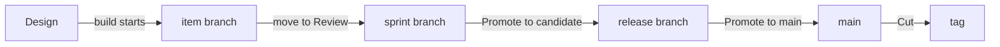

# Agile, sprints and releases with Claude

This guide takes a project from setup to a shipped release using the `agile` process, with sprints and
releases. You don't need to learn any commands:

- **You talk to Claude** for everything except decisions and pushes. Use your own words. The ones
  here are only examples.
- **You decide on the monitor:** approvals and sign-offs on the **Review** page, promotions and the
  cut on the **Releases** page.
  Claude tells you what is waiting there and links to it. It never records a decision, and it
  doesn't ask for one in a plan or a question. What Claude already knows, such as a CI run's
  result or what a sign-off covered, arrives filled in beside the button: you check it and click.
- **You can delegate the small decisions.** Tell Claude which ones it may take, such as the design
  review of small defects, and until when. It proposes a delegation; you grant it on the
  **Review** page. Whatever Claude decides under it comes back there for you to keep or undo.
- **You push from your terminal.** Nothing reaches your remote server until you do.

Prefer to run the commands yourself? See [Agile from the command line](agile-cli.md). For the other
processes, see the [guides index](index.md) and [Processes](../using/processes.md).

## Three clocks

Three things move at their own pace:

| | What it answers | Moves when |
|---|---|---|
| **Stage** | How far has this item got? | Its gates are met, one item at a time |
| **Sprint** | What are we working on these two weeks? | You ask Claude to start or close it |
| **Release** | What has reached users? | You promote it on the Releases page |

An item can be merged into its sprint and still not released. **An item is released only when a
release that holds it is cut.**

## Setting it up

> Start using kanbanr for this project. Use the agile process.

Claude asks where the board should live and what the project is for, then writes a plan. **Accepting
the plan applies it.** The agile process turns sprints and releases on by default, and Claude also
turns on the git model, so branches are made for you.

> Agree a charter with me first, then set up release stages so that main has to be pushed before
> anything is tagged. Use only candidate, main and production.

Every item links to a goal in the charter. The recommended release stages are candidate, main and
production. Production, the cut, is refused until main is pushed.

> Open the monitor, with writes on.

Keep it open. Every decision below happens there.

## Planning a sprint

> Start a two-week sprint for the saved basket. Put it in, for release 1.0.

Setup doesn't create a sprint or a release, so Claude asks the sprint's goal and first day, and the
release's version and target, when you first ask. Then it creates the sprint and its branch, adds the item and plans it into the sprint and the release.
Your checkout doesn't move. A sprint and a release don't have to line up: one release can take items
from several sprints.

## One item, stage by stage

> A shopper opens their basket on our shop's web page, leaves, and comes back the next day to find what they chose still there. Take it to Design.

**Claude asks whether it has a user interface.** When you choose the technology (or, if you don't,
when the first item is designed), Claude asks whether the product has screens a person uses, or is
a service, library or command-line tool. If it has screens, they become items of their own,
designed and approved like the rest. If it has none, that goes into the design, so a missing screen
is a decision and not an oversight.

| Stage | What Claude does | What you do on the Review page |
|---|---|---|
| **Plan** | Writes what it is and why | Nothing |
| **Design** | Drafts the definition: statement, goals and requirements | **Approve** |
| **Develop** | Writes the design and its task list, names a test for each requirement, and starts the item's branch | **Sign off design-review** |
| **Test** | Builds on the item's branch and commits | Nothing |
| **Review** | Records the green tests and updates the docs | **Sign off docs-folded** |
| **Released** | Nothing: the cut moves it here | Nothing |

**Approve first, then sign off.** An item with both waiting shows **Approve**, then **Sign off** once
you've approved it, so check back after approving.

**Each approval covers the text you saw.** Adding to the definition keeps the approval, and what was
added is reviewed at the next decision. Changing or removing approved text lapses it, and the item
returns to the Review page.

**Moving to Review is the merge.** kanbanr merges the item's branch into the sprint's branch. It isn't
released yet.

**Agile asks for no release sign-off.** In this process a release only needs every item to have
reached Review, so there is no per-item sign-off at the release.

If something is missing for a move, Claude tells you what and either fixes it or asks you. Nothing
moves past a gate unless you say why, and that reason stays on the item.

### Chores

A chore doesn't walk every stage. It goes Plan → Develop → Test → Released, skipping Design and Review, because their
questions don't fit small maintenance work. Tell Claude it's a chore when you ask for it.

> Pin the CI image: it's a chore.

Before its first move Claude asks once for what every item records: a one-sentence statement, the goal
it serves, and a requirement in the EARS form that says how it's verified. You still approve it before work starts. A chore has no Design section and no **design-review**. If
you change an item's kind to a chore while it's at a stage the chore path leaves out, it's off
the path: it moves by the ordinary moves, or back to Plan.

## When an item is done for a sprint

The agile process marks no stage as done other than **Released**. The sprint we followed was closed
after the cut, and nothing carried over. If your sprints end before your releases do, ask Claude
whether to count Review as done for a sprint. I did not see a sprint closed before its release in this
process.

## Feedback on a release

Feedback arrives as new items that name the version they were found in:

> Customers found a problem in v1.0.0 with the saved basket. Add it as an item found in v1.0.0.

A defect in a shipped release needs its own fix. See
[Patch releases](../using/processes.md#patch-releases).

## Handing work to sub-agents

> Have a sub-agent build these tasks.

Claude gives each agent a scope, which kanbanr enforces. An agent can record its own tasks and tests
and commit on its own branch. It can't move items, approve anything or push. You'll see its progress on
the item's page, and its scope on the **Workflow** page.

Claude stays in the project folder while an agent works, and looks inside the agent's worktree
without moving into it (`git -C`), so a scope never gets in your way or Claude's. Revoking an agent's
scope stops that agent on its next tool call and never restricts you.

## Releasing

**Before your first release, design the pipeline.** A release workflow can only be tested by running
it, a tag can't be moved once it's pushed, and shipped notes can't be edited, so a mistake in the
pipeline costs a whole version number. Settle the checks, the release description and a run without a tag first:
see [Designing CI and the release workflow](delivery-pipeline.md).

| Step | Who | Do this |
|---|---|---|
| 1 | You | **Releases** page: **Promote to candidate**. This makes the release branch and drafts the version, changelog and notes |
| 2 | Claude | Say "Write the release notes for readers", because the draft only lists requirements |
| 3 | You | Open **Release notes** on the release, then **Edit notes** and **Save** for any changes |
| 4 | Claude | Say "Run the full checks over the release" |
| 5 | You | **Releases** page: **Promote to main**. This moves main to the release, without tagging |
| 6 | You | Terminal: `git push origin main`, then wait for CI to go green |
| 7 | You | **Releases** page: **Check again**, then **Cut v1.0.0**. This tags main and moves the items to Released, unless your stages continue after the tag: then **Confirm** each later stage, and the last one moves the items |
| 8 | You | Terminal: `git push origin v1.0.0` |
| 9 | Claude | Say "The release is out. Bring it forward into the sprint" |

**Each button says what it will do**, and stays greyed out with the reason until it's ready.

**Freeze the candidate.** Once a release is a candidate, send anything new to the next release and
change only the notes.

**Promoting moves main, not your checkout.** Your remote server won't change until you push.

**The date follows the release.** Promoting to main dates the notes and changelog today. If main moved
earlier and the cut comes later, the page warns you: ask Claude to re-date them before you cut,
because shipped notes can't be edited.

## Closing the sprint

> Close the sprint and do a retro.

Claude closes it and writes the retro with you. This changes only the board. Start the next sprint
before starting new items, because new items branch from the running sprint.

After the cut, ask Claude to check for leftovers. The merged item branch is safe to delete, and Claude
will say so.

## Who does what

| | You | Claude |
|---|---|---|
| **Definitions** | Answer what only you know, then **Approve** | Draft them and keep the spec current |
| **Design** | **Sign off design-review** | Write the design and its task list |
| **Code and tests** | Review what you want to | Build, or give the work to sub-agents, and record results |
| **Merging an item** | **Sign off docs-folded** | Update the docs and move the item |
| **Sprints** | Say what goes in and when it closes | Create, plan and close them |
| **Releases** | Each **Promote** and the **Cut** | Write the notes, run the checks, bring it forward |
| **Remote server** | **Every push** of code and tags, and the board | Nothing |

## What Claude runs

You never need these. [Agile from the command line](agile-cli.md) covers them step by step.

| You asked for | Claude runs |
|---|---|
| Set up the process | `kanbanr config workflow --preset agile`, `kanbanr config cadence` |
| A sprint | `kanbanr sprint add`, `kanbanr sprint start`, `kanbanr sprint plan`, `kanbanr sprint unplan` |
| A release | `kanbanr release add`, `kanbanr release plan` |
| Moving an item | `kanbanr move` |
| Starting the build | `kanbanr start` |
| Release notes | `kanbanr release notes` |
| Bringing a release forward | `kanbanr git forward` |
| Closing a sprint | `kanbanr sprint close`, `kanbanr retro` |

To take an item out of the sprint, ask Claude to take it out; it goes back to no sprint.
