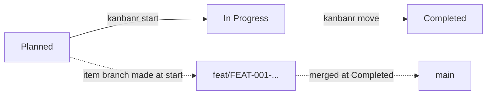

# The default workflow from the command line

This guide takes one item from setup to done under the default workflow, with you running each
command. To work by talking to Claude instead, see [The default workflow with Claude](default-with-claude.md).

The commands and output come from a real run on a scratch project. `<tmp>` stands for a temporary
folder.

## The stages

The default workflow has three stages you work in and a few you park work in:

| Status | Meaning |
|---|---|
| **Planned** | Where items start |
| **In Progress** | Work has started, on the item's own branch |
| **Completed** | Done, and merged |
| Deferred, Ongoing | Parked for later, or work that recurs and never completes |
| No Action, Not Applicable, Out-of-Scope | Set aside on purpose |

It uses no sprints and no releases. With them off, the git model is **trunk**: items branch from
`main` and merge back into `main`. Completing an item is the merge.



## Setting it up

In your project folder, which must already be a git repository:

```text
kanbanr init shop --data-dir <tmp>/shop-board --author Ada --email ada@example.com
kanbanr config workflow --preset default
kanbanr config cadence --git-model on
kanbanr git install-hooks
```

New projects already get the default workflow, so the second line only makes it explicit.
`kanbanr config cadence` confirms that sprints and releases are off:

```text
sprints off, releases off, estimates in days
```

`kanbanr git model` shows what the git model will do. Nothing is pushed for you:

```text
topology:   trunk
main:       main
line:       main
branch at:  main
production: at the integrate merge
items:      feat/{code}-{slug}, fix/{code}-{slug}, spike/*
protected:  main, sprint/*, release/*
kanbanr merges:
  - each item branch into main when the item enters the integrate stage (--no-ff, naming the item)
pushing:    never automatic — you review and push
automation: on — start, sprints and the hooks follow this model
```

### The charter comes first

**The gates are not enforced until the project has a charter**, and an item created before the
charter was adopted is exempt from them. Without one, moves that should be refused still succeed,
but each says what the gate would have needed and that `kanbanr charter set` turns the gates on.
So agree the charter before creating any items:

```text
kanbanr charter set --file charter.yaml
```

```text
charter saved for 'shop': 1 goal(s) G-1
```

## Adding an item

```text
kanbanr milestone add --name "Carts"
kanbanr feature add --title "Restore the cart" --milestone MS-001 --spec "# Restore the cart"
```

```text
created milestone MS-001
created FEAT-001 (Planned)
```

## Starting work

The default workflow asks for nothing to enter Planned. To enter **In Progress** it asks for a
definition, an approval, a `## Design` section in the spec, and the `design-review` sign-off.
`kanbanr check` lists what is still missing:

```text
kanbanr check FEAT-001
```

```text
✗ FEAT-001 Restore the cart
    no definition — why it exists, what must be true, how it is verified (`kanbanr feature define`)
    → to move to In Progress, still needed:
        no definition — why it exists, what must be true, how it is verified (`kanbanr feature define`)
        the spec has no 'Design' section — add it as a heading, with its content
        no sign-off 'design-review' — `kanbanr signoff FEAT-001 design-review`

0/1 ready
```

Trying to start now is refused. It says what's missing, makes no branch and leaves your checkout
where it is:

```text
kanbanr start FEAT-001 --to "In Progress"
```

```text
error: unsupported operation: cannot move FEAT-001 to 'In Progress': no definition — why it exists, what must be true, how it is verified (`kanbanr feature define`); the spec has no 'Design' section — add it as a heading, with its content; no sign-off 'design-review' — `kanbanr signoff FEAT-001 design-review`. To proceed anyway, record why with --override "<reason>"
```

Meet each need in turn. Write the definition and the spec's design, then sign off the design:

```text
kanbanr feature define FEAT-001 --file definition.yaml
kanbanr feature edit FEAT-001 --spec-file spec.md
kanbanr signoff FEAT-001 design-review
```

```text
defined FEAT-001: 1 requirement(s)
updated FEAT-001
FEAT-001: sign-off 'design-review' recorded by Ada
```

`kanbanr feature define --template` prints a skeleton for the definition file. The spec file needs a
heading called `Design`, written at implementation level, ending with a task list.

Starting is still refused, because nobody has approved the definition:

```text
kanbanr start FEAT-001 --to "In Progress"
```

```text
created feat/FEAT-001-restore-the-cart from main
error: unsupported operation: cannot move FEAT-001 to 'In Progress': not approved. To proceed anyway, record why with --override "<reason>"
```

**An edit to the definition lapses your approval**, so approve once the definition is as you want it:

```text
kanbanr approve FEAT-001
kanbanr start FEAT-001 --to "In Progress"
```

```text
FEAT-001 approved by Ada
created feat/FEAT-001-restore-the-cart from main
FEAT-001 -> In Progress
```

## Doing the work

Work on the item's branch. Commit with `kanbanr commit`, which names the item in the commit:

```text
git add -A
kanbanr commit -m "feat: restore the cart"
```

```text
[feat/FEAT-001-restore-the-cart 9a5061a] feat: restore the cart
 1 file changed, 1 insertion(+)
 create mode 100644 cart.txt
```

## Finishing

`kanbanr check` shows what Completed asks for, and what the requirements still lack:

```text
kanbanr check FEAT-001
```

```text
✗ FEAT-001 Restore the cart
    R-1 has tests but none is green — not yet proven
    → to move to Completed, still needed:
        no sign-off 'docs-folded' — `kanbanr signoff FEAT-001 docs-folded`

0/1 ready
```

Completed asks for the `docs-folded` sign-off: the Design has been folded into the docs it
affects. Moving without it is refused, so give it and move:

```text
kanbanr move FEAT-001 "Completed"
kanbanr signoff FEAT-001 docs-folded
kanbanr move FEAT-001 "Completed"
```

```text
error: unsupported operation: cannot move FEAT-001 to 'Completed': no sign-off 'docs-folded' — `kanbanr signoff FEAT-001 docs-folded`. To proceed anyway, record why with --override "<reason>"
FEAT-001: sign-off 'docs-folded' recorded by Ada
FEAT-001 -> Completed
merged feat/FEAT-001-restore-the-cart into main (52dd737ee47d)
```

**Completed is the merge.** kanbanr merges the item's branch into `main` with `--no-ff`, naming the
item. Your checkout stays on the item's branch:

```text
git log --oneline --all --graph
```

```text
*   52dd737 Merge feat/FEAT-001-restore-the-cart into main
|\
| * 9a5061a feat: restore the cart
|/
* 1f0a61c select the board
* 403525e first commit
```

Notice that `kanbanr check` still reports the requirement as unproven, because the test was never
recorded green:

```text
R-1 has tests but none is green — not yet proven
```

The move to Completed went through anyway. Record test results with `kanbanr test` before you move,
so that the requirement is proven when the item is done.

## After the merge

```text
kanbanr board
```

```text
# shop board

## Planned (0)

## In Progress (0)

## Completed (1)
  - FEAT-001 Restore the cart [0/0]
```

`kanbanr doctor` reminds you to delete the merged branch:

```text
shop FEAT-001: FEAT-001 is finished and feat/FEAT-001-restore-the-cart is merged: delete it with `git branch -d feat/FEAT-001-restore-the-cart`
```

Pushing `main` is yours, from your terminal: kanbanr never pushes.

## Parking work

Not everything is done in order. Park work with `kanbanr move`:

| To | Use for |
|---|---|
| Deferred | Not now |
| Ongoing | Work that recurs and never completes |
| No Action, Not Applicable, Out-of-Scope | A decision not to do it |

All of them can return to Planned.

## When things go wrong

| You see | It means | Do this |
|---|---|---|
| Moves succeed that shouldn't | No charter, or the item predates it | Set the charter before creating items |
| `not approved` | Nobody approved the definition, or it changed since | Read it, then `kanbanr approve` |
| `the spec has no 'Design' section` | Entering In Progress needs a design | Add a `Design` heading to the spec |
| A branch exists but the item is still Planned | `kanbanr start` makes the branch before checking the gate | Meet the gate, then run `kanbanr start` again |
| `R-1 has tests but none is green` after Completed | The move did not ask for green tests | Record them with `kanbanr test` |

A move can also go past its gate with `--override "<reason>"`, and the reason stays on the item. Save
it for real exceptions.
