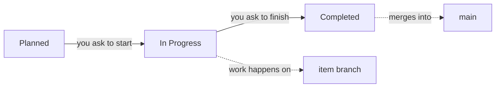

# The default workflow with Claude

This guide takes a project from setup to finished work under the default workflow: plan, work,
finish. You don't need to learn any commands:

- **You talk to Claude** for everything except decisions and pushes. Use your own words. The ones
  here are only examples.
- **You decide on the monitor:** approvals and sign-offs on the **Review** page.
  Claude tells you what is waiting there and links to it. It never records a decision, and it
  doesn't ask for one in a plan or a question.
- **You push from your terminal.** Nothing reaches your remote server until you do.

Prefer to run the commands yourself? See [The default workflow from the command line](default-cli.md).
To compare processes, see the [Process guides](index.md) and
[Processes](../using/processes.md).

## Stages

| Status | Meaning |
|---|---|
| **Planned** | Where items start |
| **In Progress** | Work has started, on the item's own branch |
| **Completed** | Done, and merged |
| Deferred, Ongoing | Parked for later, or work that recurs and never completes |
| No Action, Not Applicable, Out-of-Scope | Set aside on purpose |

**It uses no sprints and no releases by default.** There's no sprint to close and no release to cut.
Items branch from `main` and merge back into `main`, and the merge happens when the item is
Completed. If you want sprints or releases later, say so and Claude will show you what changes
before it changes anything.

## Setting it up

> Start using kanbanr for this project. Use the default workflow.

Claude asks where the board should live and what the project is for, then writes a plan showing the
process and the branches. **Accepting the plan applies it.** It recommends no sprints and no
releases for this process.

**Do the charter first.** Gates aren't enforced until a project has a charter, and items created
before it are exempt. Claude asks for the project's purpose and goals, and every item then links to
a goal.

> Open the monitor, with writes on.

Keep it open. Every decision below happens there.

## One item, start to finish

> We need saved carts: shoppers should be able to come back to their basket.

Claude asks only what it can't work out, then writes the item. It starts in Planned. Entering
**In Progress** is where the default workflow asks for things, and Completed asks for a little more:

| Stage | What Claude does | What you do on the Review page |
|---|---|---|
| **Planned** | Writes what it is, why, and the requirements, each with a named test | **Approve** |
| **In Progress** | Writes the design and its task list into the spec, then builds on the item's branch | **Sign off design-review** first |
| **Completed** | Records the test results, folds the design into the docs, then merges | **Sign off docs-folded** |

**An item counts as done when it reaches Completed and its branch is merged.** There's no sprint or
release behind that.

**Approve first, then sign off.** Each approval covers the text you saw. Adding to the definition
keeps the approval, and what was added is reviewed at the next decision. Changing or removing
approved text lapses it, and the item returns to the Review page. Read what changed, then approve
again.

**Just ask to move it on:**

> Start the cart restore.
>
> The cart restore is finished. Complete it.

If something is missing, Claude tells you what and either fixes it or asks you. Nothing moves past a
gate unless you say why, and that reason stays on the item.

**Ask Claude to prove the tests first.** In the run this guide is based on, an item moved to
Completed with its test never recorded as green. Ask Claude to run the tests and record the results
before it finishes the item, and to check that each requirement is proven.

**Completing is the merge.** kanbanr merges the item's branch into `main`, naming the item. Nothing
is pushed. Claude will remind you that the merged branch can be deleted.

## Parking work

Not everything goes in order. Ask in plain words:

> Park the wishlist, we're not doing it this quarter.
>
> This is routine work that never ends. Mark it Ongoing.
>
> We decided against it. Mark it Out-of-Scope.

Deferred, Ongoing and the three "set aside" statuses all go back to Planned when you want them.

## Handing work to sub-agents

> Have a sub-agent build these tasks.

Claude gives each agent a scope, which kanbanr enforces. An agent can record its own tasks and test
results and commit on its own branch. It can't move items, approve anything or push. You'll see its
progress on the item's page, and Claude reviews its branch before bringing you any decision.

## Who does what

| | You | Claude |
|---|---|---|
| **Definitions** | Answer what only you know, then **Approve** | Draft them and keep them current |
| **Design** | **Sign off design-review** | Write the design and its task list |
| **Code and tests** | Review what you want to | Build, record results, update the docs |
| **Finishing** | **Sign off docs-folded** | Move the item and merge |
| **Remote server** | **Every push** | Nothing |

## When things go wrong

| You see | It means | Do this |
|---|---|---|
| Moves go through that shouldn't | No charter, or the item is older than it | Ask Claude to agree a charter before creating items |
| An item is back on the Review page | Its definition changed after you approved it | Read the change, then **Approve** again |
| A branch exists but the item is still Planned | Starting made the branch before the gate was checked | Meet the gate, then ask Claude to start it again |
| An item is Completed but a requirement isn't proven | The move didn't ask for green tests | Ask Claude to run and record the tests |

## What Claude runs

You never need these, but here they are if you're curious. [The default workflow from the command
line](default-cli.md) covers them step by step.

| You asked for | Claude runs |
|---|---|
| Set up the process | `kanbanr config workflow --preset default` |
| Branches that follow the process | `kanbanr config cadence --git-model on` |
| The charter | `kanbanr charter set` |
| A new item | `kanbanr feature add`, `kanbanr feature define` |
| The design | `kanbanr feature edit` |
| Starting | `kanbanr start` |
| Committing | `kanbanr commit` |
| Finishing | `kanbanr move` |
| A sub-agent | `kanbanr scope issue` |
