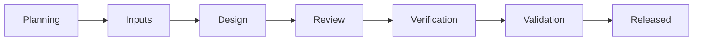

# Design control with Claude

This guide takes one item through the `design-control` process, from planning to released. The
process is modelled on the controls of ISO 9001 clause 8.3 (design and development). It is modelled
on them, not a claim of compliance: that is for a certification body to decide.

You don't need to learn any commands:

- **You talk to Claude** for everything except decisions and pushes. Use your own words. The ones
  here are only examples.
- **You decide on the monitor:** approvals and sign-offs on the **Review** page.
  Claude tells you what is waiting there and links to it. It never records a decision, and it
  doesn't ask for one in a plan or a question.
- **You push from your terminal.** Nothing reaches your remote server until you do.

Prefer to run the commands yourself? See [Design control from the command line](design-control-cli.md).
For the other processes, see the [guides index](index.md) and
[Processes: presets, gates and sign-offs](../using/processes.md).

## How it differs from the others

- **It uses no sprints and no releases by default.** Setting it up turns the git model on and leaves
  sprints and releases off. Work goes from an item's branch straight to `main`, so there is no
  release to promote and no cut. You can turn sprints and releases on later if you want them.
- **Released is a stage, not an event.** An item is Released when you sign off its validation. That
  is the end of the process.
- **It asks for four sign-offs.** Each one is your recorded decision, at the stage that needs it.
- **Merging happens at Validation**, not at Released. See the table below.

## The stages

You can send an item back to Design from Review, Verification, Validation or Released. An item that
turns out not to need work can go to No Action, Not Applicable or Out-of-Scope.

## Setting it up

> Start using kanbanr for this project. Use the design-control process.

Claude asks where the board should live and what the project is for, then writes a plan. **Accepting
the plan applies it.**

> Agree a charter with me first.

**Do the charter first.** Gates aren't enforced until a project has one, and items created before it
are exempt. Claude asks for the project's purpose and goals. Every item then links to a goal.

> Open the monitor, with writes on.

Keep it open. Every decision below happens there.

## One item, stage by stage

Ask for the work in your own words, and Claude asks only what it can't work out.

> A shopper opens their basket on our shop's web page, leaves, and comes back the next day to find what they chose still there. Take it through design control.

**Claude asks whether it has a user interface.** When you choose the technology (or, if you don't,
when the first item is designed), Claude asks whether the product has screens a person uses, or is
a service, library or command-line tool. If it has screens, they become items of their own,
designed and approved like the rest. If it has none, that goes into the design, so a missing screen
is a decision and not an oversight.

| Stage | What Claude does | What you do on the Review page |
|---|---|---|
| **Planning** | Creates the item and writes what it is | Nothing |
| **Inputs** | Records the statement, the goal it serves and the requirements, each in the EARS form | Nothing |
| **Design** | Makes the item's branch, writes the design and its task list, and names a test for each requirement | **Approve**, then **Sign off design-review** |
| **Review** | Reviews the design against the inputs | Nothing |
| **Verification** | Checks the outputs meet the inputs | **Sign off verification-review** |
| **Validation** | Builds and runs the tests, updates the docs, then merges the branch into `main` | **Sign off docs-folded** |
| **Released** | Nothing | **Sign off validation** |

**Approve first, then sign off.** An item with both waiting shows **Approve**, then **Sign off** once
you've approved it, so check back after approving.

**Each sign-off is your decision, recorded.** Claude never gives one for you. If it isn't there, the
item stays where it is and Claude tells you which one is missing.

**Just ask to move it on:**

> Move the saved basket on to Design.

If something's missing, Claude tells you what and either fixes it or asks you. Nothing moves past a
gate unless you say why, and that reason stays on the item.

**Review has no sign-off of its own.** The review is recorded as the `verification-review` sign-off
you give before Verification starts.

### Chores

A chore doesn't walk every stage. It goes Planning → Design → Verification → Released, skipping Inputs, Review and Validation, because their
questions don't fit small maintenance work. Tell Claude it's a chore when you ask for it.

> Pin the CI image: it's a chore.

Before its first move Claude asks once for what every item records: a one-sentence statement, the goal
it serves, and a requirement in the EARS form that says how it's verified. You still approve it, and the sign-offs that belong to the stages it enters (such as the one before release) are still yours. A chore has no Design section and no **design-review**. If
you change an item's kind to a chore while it's at a stage the chore path leaves out, it's off
the path: it moves by the ordinary moves, or back to Planning.

## When an item counts as done

Only **Released** ends the process. Until you sign off validation, the item is not finished, even
when its code is already merged. Merging into `main` happens when the item enters Validation, so the
code can be on `main` while the item is still waiting for your last sign-off.

If you turn sprints on, ask Claude how you want an item to count as done for a sprint, because
Released is the only end stage.

## Handing work to sub-agents

> Have a sub-agent build these tasks.

Claude gives each agent a scope, which kanbanr enforces. An agent can record its own tasks and test
results and commit on its own branch. It can't move items, approve anything, give a sign-off or push.
Its progress shows on the item's page, and its scope on the **Workflow** page. When it finishes,
Claude reviews the branch and brings you any decisions.

Claude stays in the project folder while an agent works, and looks inside the agent's worktree
without moving into it (`git -C`), so a scope never gets in your way or Claude's. Revoking an agent's
scope stops that agent on its next tool call and never restricts you.

## Pushing

Moving an item through the process doesn't push anything. Merging into `main` happens on your
machine only.

> The saved basket is released. What do I push?

Claude tells you. Then you push `main` from your terminal.

## Who does what

| | You | Claude |
|---|---|---|
| **Inputs** | Answer what only you know | Draft the statement and requirements |
| **Design** | **Approve**, then **Sign off design-review** | Write the design and its task list |
| **Verification** | **Sign off verification-review** | Check outputs against inputs |
| **Code and tests** | Review what you want to | Build, or give the work to sub-agents, and record results |
| **Merging** | **Sign off docs-folded** | Update the docs and move the item |
| **Release** | **Sign off validation** | Move the item |
| **Remote server** | **Every push** | Nothing |

## When things go wrong

| You see | It means | Do this |
|---|---|---|
| Moves go through that shouldn't | No charter, or the item is older than it | Ask Claude to agree a charter before creating items |
| An item is back on the Review page | Its definition changed after you approved it | Read the change, then **Approve** again |
| A move is refused for a missing sign-off | You haven't given the one that stage asks for | Sign off on the Review page |
| A move to Validation is refused for tests | A requirement has no green test yet | Ask Claude to build and run it |
| The board warns a finished item's branch is merged | The branch is no longer needed | Ask Claude to delete it |

## What Claude runs

You never need these, but here they are if you want to check what Claude did.
[Design control from the command line](design-control-cli.md) covers them step by step.

| You asked for | Claude runs |
|---|---|
| Set up the process | `kanbanr config workflow --preset design-control` |
| The git model | `kanbanr config cadence --git-model on` |
| The charter | `kanbanr charter set` |
| A new item | `kanbanr feature add`, `kanbanr feature define` |
| Checking what's missing | `kanbanr check` |
| Starting the build | `kanbanr start` |
| Moving an item | `kanbanr move` |
| Recording test results | `kanbanr test` |
| Committing | `kanbanr commit` |
