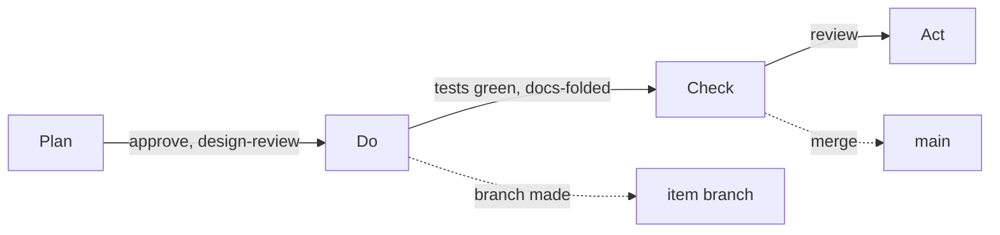

# PDCA with Claude

This guide takes one item through Plan, Do, Check and Act. You don't need to learn any commands:

- **You talk to Claude** for everything except decisions and pushes. Use your own words. The ones
  here are only examples.
- **You decide on the monitor:** approvals and sign-offs on the **Review** page.
- **You push from your terminal.** Nothing reaches your remote server until you do.

Prefer to run the commands yourself? See [PDCA from the command line](pdca-cli.md). For the other
processes, see the [guide index](index.md) and [Processes](../using/processes.md).

## What is particular to PDCA

PDCA is a small cycle. Each item goes round it once: plan the change, make it, check the result
against the plan, then act on what you learned.

| | In PDCA |
|---|---|
| **Stages** | Plan, Do, Check, Act |
| **Done** | An item is done when it reaches **Act**. Act is the end of the cycle |
| **Approval** | Once, to enter **Do** |
| **Sign-offs** | **design-review** to enter Do, **docs-folded** to enter Check, **review** to enter Act |
| **Sprints and releases** | Off by default. There is no release and no cut, so nothing is tagged |

Because there are no sprints or releases, the work goes straight to `main`. **Moving to Check is
the merge:** kanbanr merges the item's branch into `main`. It does not push.

## Setting it up

> Start using kanbanr for this project. Use PDCA.

Claude asks where the board should live and what the project is for. It also asks whether you want
sprints and releases. PDCA recommends neither. Claude shows the plan, and **accepting the plan
applies it.**

> Agree a charter with me first.

**Do the charter first.** Gates aren't enforced until a project has one, and items created before it
are exempt. Claude asks for the project's purpose and goals. Every item then links to a goal.

> Open the monitor, with writes on.

Keep it open. Claude gives you the address, and your decisions happen there.

## One item, stage by stage

Ask for the work in your own words, and Claude asks only what it can't work out.

> We need to restore a shopper's cart after they return. Plan it.

| Stage | What Claude does | What you do on the Review page |
|---|---|---|
| **Plan** | Writes the change, why, and how you will know it worked: the requirements and a named test for each | Nothing yet |
| **Do** | Writes the design and its task list, makes the item's branch, builds, commits | **Sign off design-review**, then **Approve** |
| **Check** | Runs the tests, records the results and updates the docs. Moving here merges the branch into `main` | **Sign off docs-folded** |
| **Act** | Writes what worked and what the next cycle should change | **Sign off review** |

**Approve and sign off before Do.** Do asks for an approved definition, a `## Design` section in the
spec and the `design-review` sign-off. If one is missing, Claude says which, and drafts it or brings
it to you.

**An edit lapses your approval.** Each approval covers exactly the text you saw. If the definition
changes afterwards, the item returns to the Review page. Read what changed, then approve again.

**Just ask to move it on:**

> Take the cart restore to Do.

If something's missing, Claude tells you what. Nothing moves past a gate unless you say why, and that
reason stays on the item.

**Check is where the proof goes.** An item can't enter Check until every requirement has a green
test. The tests are recorded against the commit they ran on.

**Act ends the item.** After your **Sign off review**, ask Claude to move it to Act. Claude also
writes what the next cycle should change. To run another cycle on the same item, ask Claude to move
it back to Plan.

After the merge your checkout may still be on the item's branch. `main` has moved, but your remote
server hasn't until you push.

## Handing work to sub-agents

> Have a sub-agent build these tasks.

Claude gives each agent a scope, which kanbanr enforces. An agent can record its own tasks and test
results and commit on its branch. It can't move items, approve anything or push. When it finishes,
Claude reviews the branch and brings you any decisions.

## Who does what

| | You | Claude |
|---|---|---|
| **Definitions** | Answer what only you know, then **Approve** | Draft them, ask, and keep the spec current |
| **Design** | **Sign off design-review** | Write the design and its task list |
| **Code and tests** | Review what you want to | Build, or hand to sub-agents, and record results |
| **Merging an item** | **Sign off docs-folded** | Update the docs and move the item to Check |
| **Closing the cycle** | **Sign off review** | Write what the next cycle should change, and move to Act |
| **Remote server** | **Every push** | Nothing |

## When things go wrong

| You see | It means | Do this |
|---|---|---|
| Moves go through that shouldn't | No charter, or the item is older than it | Ask Claude to agree a charter before creating items |
| An item is back on the Review page | Its definition changed after you approved it | Read the change, then **Approve** again |
| Claude says the move to Do is refused | The definition, the design, the sign-off or the approval is missing | Do what Claude names |
| Claude says the move to Check is refused | A requirement has no green test, or `docs-folded` is missing | Ask Claude to run the tests, then **Sign off docs-folded** |

## What Claude runs

You never need these. [PDCA from the command line](pdca-cli.md) covers them step by step.

| You asked for | Claude runs |
|---|---|
| Set up the process | `kanbanr config workflow --preset pdca` |
| Branches | `kanbanr config cadence --git-model on` |
| A new item | `kanbanr feature add` |
| The definition and design | `kanbanr feature define`, `kanbanr feature edit` |
| Starting the build | `kanbanr start` |
| Committing | `kanbanr commit` |
| Test results | `kanbanr test` |
| Moving an item | `kanbanr move` |
| A sub-agent | `kanbanr scope issue` |
