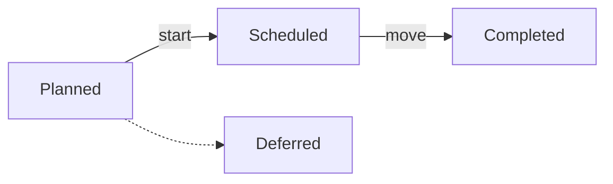

# Scheduled, from the command line

This guide takes one item through the `scheduled` process (Planned, Scheduled, Completed) with you
running each command. To work by talking to Claude instead, see
[Scheduled with Claude](scheduled-with-claude.md).

The commands and output come from a real run on a scratch project. `<tmp>` stands for a temporary
folder.

## The process



| Stage | What must be true to enter | Commands |
|---|---|---|
| **Planned** | Nothing: items start here | `kanbanr feature add` |
| **Scheduled** | A definition, approval, a `## Design` section in the spec, the `design-review` sign-off | `kanbanr feature define`, `kanbanr feature edit`, `kanbanr signoff`, `kanbanr approve`, `kanbanr start` |
| **Completed** | The `docs-folded` sign-off. The move merges the item's branch | `kanbanr signoff`, `kanbanr move` |

Deferred is a parking place. So are No Action, Not Applicable and Out-of-Scope. There are no
sprints or releases: nothing is tagged, and an item is finished when its branch merges into main.

## Setting it up

In your project folder:

```text
kanbanr init shop --data-dir <tmp>/shop-board --author Ada --email ada@example.com
kanbanr config workflow --preset scheduled
kanbanr config cadence --git-model on
kanbanr git install-hooks
```

```text
workflow updated
sprints off, releases off, estimates in days
installed commit-msg and pre-commit and pre-push in <tmp>/shop: a commit now has to say which item it serves
```

`kanbanr git model` shows what will happen. There is one line, main, and no sprint or release
branches:

```text
topology:   trunk
main:       main
line:       main
branch at:  main
production: at the integrate merge
items:      feat/{code}-{slug}, fix/{code}-{slug}, spike/*
protected:  main, sprint/*, release/*
kanbanr merges:
  - each item branch into main when the item enters the integrate stage (--no-ff, naming the item)
pushing:    never automatic — you review and push
automation: on — start, sprints and the hooks follow this model
```

Agree a charter before creating items, because gates are not enforced without one. A move that
should be refused still succeeds, but says what the gate would have needed and that
`kanbanr charter set` turns the gates on:

```text
kanbanr charter set --file <tmp>/charter.yaml
```

```text
charter saved for 'shop': 1 goal(s) G-1
```

## Creating the item

```text
kanbanr milestone add --name "Carts"
kanbanr feature add --title "Restore the cart" --milestone MS-001 --spec "# Restore the cart"
```

```text
created milestone MS-001
created FEAT-001 (Planned)
```

## Planned to Scheduled

Ask what is missing:

```text
kanbanr check FEAT-001
```

```text
✗ FEAT-001 Restore the cart
    no definition — why it exists, what must be true, how it is verified (`kanbanr feature define`)
    → to move to Scheduled, still needed:
        no definition — why it exists, what must be true, how it is verified (`kanbanr feature define`)
        the spec has no 'Design' section — add it as a heading, with its content
        no sign-off 'design-review' — `kanbanr signoff FEAT-001 design-review`

0/1 ready
```

`kanbanr start` makes the item's branch and moves the item if its gate is met. If it isn't, it
says what's missing and makes no branch:

```text
kanbanr start FEAT-001 --to "Scheduled"
```

```text
error: unsupported operation: cannot move FEAT-001 to 'Scheduled': no definition — why it exists, what must be true, how it is verified (`kanbanr feature define`); the spec has no 'Design' section — add it as a heading, with its content; no sign-off 'design-review' — `kanbanr signoff FEAT-001 design-review`. To proceed anyway, record why with --override "<reason>"
```

Meet each gap. Write the definition, add a `## Design` section to the spec, and give the
`design-review` sign-off:

```text
kanbanr feature define FEAT-001 --file <tmp>/definition.yaml
kanbanr feature edit FEAT-001 --spec-file <tmp>/spec.md
kanbanr signoff FEAT-001 design-review
```

```text
defined FEAT-001: 1 requirement(s)
updated FEAT-001
FEAT-001: sign-off 'design-review' recorded by Ada
```

Approval is still needed. The refusal says so:

```text
kanbanr start FEAT-001 --to "Scheduled"
```

```text
created feat/FEAT-001-restore-the-cart from main
error: unsupported operation: cannot move FEAT-001 to 'Scheduled': not approved. To proceed anyway, record why with --override "<reason>"
```

```text
kanbanr approve FEAT-001
kanbanr start FEAT-001 --to "Scheduled"
```

```text
FEAT-001 approved by Ada
created feat/FEAT-001-restore-the-cart from main
FEAT-001 -> Scheduled
```

## The work

Work on the item's branch and commit with `kanbanr commit`, which adds `Refs: kanbanr:FEAT-001`:

```text
git add -A
kanbanr commit -m "feat: restore the cart"
```

```text
[feat/FEAT-001-restore-the-cart 88f968e] feat: restore the cart
 1 file changed, 1 insertion(+)
 create mode 100644 cart.txt
```

## Scheduled to Completed

```text
kanbanr move FEAT-001 "Completed"
```

```text
error: unsupported operation: cannot move FEAT-001 to 'Completed': no sign-off 'docs-folded' — `kanbanr signoff FEAT-001 docs-folded`. To proceed anyway, record why with --override "<reason>"
```

Give the sign-off, then move. The move merges the branch into main:

```text
kanbanr signoff FEAT-001 docs-folded
kanbanr move FEAT-001 "Completed"
```

```text
FEAT-001: sign-off 'docs-folded' recorded by Ada
FEAT-001 -> Completed
merged feat/FEAT-001-restore-the-cart into main (9837a0e70aa0)
```

Your checkout stays on the item's branch. The history shows the merge naming the item:

```text
*   9837a0e Merge feat/FEAT-001-restore-the-cart into main
|\
| * 88f968e feat: restore the cart
|/
* 0df855e select the board
* 403525e first commit
```

Nothing was pushed. Review, then `git push origin main` yourself.

## When things go wrong

| You see | It means | Do this |
|---|---|---|
| `cannot move … to 'Scheduled': not approved` | The definition has no approval, or it lapsed | `kanbanr approve FEAT-001` |
| `the spec has no 'Design' section` | The build stage needs a design in the spec | Add a `## Design` heading and content with `kanbanr feature edit` |
| `no sign-off 'docs-folded'` | The merge stage needs a person's sign-off | `kanbanr signoff FEAT-001 docs-folded` |
| `R-1 has tests but none is green` from `kanbanr check` | A requirement isn't proven | Record a passing test. See the note below |
| `kanbanr doctor` says the item's branch is merged | The branch is no longer needed | `git branch -d feat/FEAT-001-restore-the-cart` |

A move can also go past its gate with `--override "<reason>"`, and the reason stays on the item.
Save it for real exceptions.

**Note.** In the run above, `kanbanr check` still said `R-1 has tests but none is green` after the
item was Completed. The move was allowed, so a manual `kanbanr move` didn't ask for green tests.
Don't rely on it: record the test results before you move.
