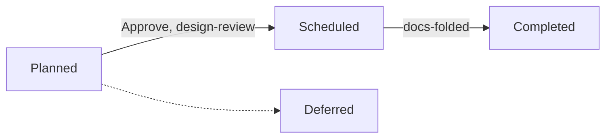

# Scheduled with Claude

This guide takes a project from setup to merged work using the `scheduled` process: Planned,
Scheduled, Completed. It has no sprints and no releases. You don't need to learn any commands:

- **You talk to Claude** for everything except decisions and pushes. Use your own words. The ones
  here are only examples.
- **You decide on the monitor:** approvals and sign-offs on the **Review** page.
- **You push from your terminal.** Nothing reaches GitHub until you do.

Prefer to run the commands yourself? See [Scheduled from the command line](scheduled-cli.md). To
compare processes, see [Process guides](index.md) and
[Processes](../using/processes.md).

## How it works



| Stage | Meaning |
|---|---|
| **Planned** | The idea is written down. Items start here |
| **Scheduled** | It has been agreed and designed, and work is under way on its branch |
| **Completed** | Its branch has merged into main |

Deferred holds work for later. No Action, Not Applicable and Out-of-Scope close an item without doing
it.

**An item is done when it is Completed.** There are no sprints to close, so nothing carries over.
**There are no releases by default**: Completed means the branch merged into main, and nothing is
tagged.

## Setting it up

> Start using kanbanr for this project. Use the scheduled process.

Claude asks where the board should live and what the project is for, then writes a plan. **Accepting
the plan applies it.**

> Agree a charter with me first.

**Do the charter first.** Gates aren't enforced until a project has one, and items created before it
are exempt.

> Open the monitor, with writes on.

## One item, stage by stage

> We need saved carts: shoppers should be able to come back to their basket. Schedule it.

| Stage | What Claude does | What you do on the Review page |
|---|---|---|
| **Planned** | Writes what it is and why | Nothing yet |
| **Scheduled** | Drafts the definition, writes the design in the spec, makes the item's branch | **Sign off design-review**, then **Approve** |
| **Completed** | Builds, runs the tests, updates the docs and merges | **Sign off docs-folded** |

**You decide twice per item:** the design-review sign-off and the approval to start, and the
docs-folded sign-off to finish. Claude asks for each and never gives it.

**Each approval covers the text you saw.** If the definition changes, your approval lapses and the
item returns to the Review page. Read what changed, then approve again.

**Just ask to move it on.** If something is missing, Claude says what and either fixes it or asks
you:

> Schedule the cart restore.

Claude commits on the item's branch.

**Moving to Completed is the merge.** kanbanr merges the item's branch into main, naming the item.
Your checkout may stay on the item's branch. Nothing is pushed.

> Mark the cart restore as complete.

**Ask for the tests first.** Under this process a requirement without a green test doesn't stop the
move, so say "run the tests and record them before you complete it".

## Handing work to sub-agents

> Have a sub-agent build these tasks.

Claude gives each agent a scope, which kanbanr enforces. An agent can record its own tasks and test
results and commit on its branch. It can't move items, approve anything or push. See
[Sub-agents and agent scopes](../using/with-claude.md#sub-agents-and-agent-scopes).

## Pushing

When items have merged and you're happy, push from your terminal:

```text
git push origin main
```

Claude can't push. After an item merges, Claude may point out that its branch can be deleted.

## Who does what

| | You | Claude |
|---|---|---|
| **Definitions** | Answer what only you know, then **Approve** | Draft them and keep the spec current |
| **Design** | **Sign off design-review** | Write it into the spec |
| **Code and tests** | Review what you want to | Build, or give the work to sub-agents, and record results |
| **Finishing** | **Sign off docs-folded** | Update the docs and move the item |
| **GitHub** | **Every push** | Nothing |

## When things go wrong

| You see | It means | Do this |
|---|---|---|
| Moves go through that shouldn't | No charter, or the item is older than it | Ask Claude to agree a charter |
| An item is back on the Review page | Its definition changed after you approved it | Read the change, then **Approve** again |
| Claude says a branch can be deleted | The item is merged | Ask Claude to delete it |
| You need releases or sprints | The process doesn't use them | See [TOGAF with Claude](togaf-with-claude.md) for a process that does |

## What Claude runs

You never need these. [Scheduled from the command line](scheduled-cli.md) covers them.

| You asked for | Claude runs |
|---|---|
| Set up the process | `kanbanr config workflow --preset scheduled` |
| Branches and hooks | `kanbanr config cadence --git-model on`, `kanbanr git install-hooks` |
| A definition | `kanbanr feature define` |
| The design | `kanbanr feature edit` |
| Scheduling an item | `kanbanr start` |
| Committing | `kanbanr commit` |
| Completing an item | `kanbanr move` |
| A sub-agent | `kanbanr scope issue` |
