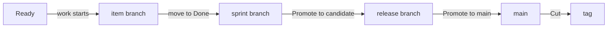

# Scrum, sprints and releases with Claude

This guide takes a project from setup to a shipped release using Scrum: a backlog refined to Ready,
worked in sprints, reviewed and tested to Done, and released in increments. You don't need to learn
any commands:

- **You talk to Claude** for everything except decisions and pushes. Use your own words. The ones
  here are only examples.
- **You decide on the monitor:** approvals and sign-offs on the **Review** page, promotions and the
  cut on the **Releases** page.
  Claude tells you what is waiting there and links to it. It never records a decision, and it
  doesn't ask for one in a plan or a question. What Claude already knows, such as a CI run's
  result or what a sign-off covered, arrives filled in beside the button: you check it and click.
- **You push from your terminal.** Nothing reaches your remote server until you do.

Prefer to run the commands yourself? See [Scrum from the command line](scrum-cli.md). For the other
processes, see the [guides index](index.md) and [Processes](../using/processes.md).

## Three clocks

| | What it answers | Moves when |
|---|---|---|
| **Stage** | How far has this item got? | Its gates are met, one item at a time |
| **Sprint** | What are we working on these two weeks? | You ask Claude to start or close it |
| **Release** | What has reached users? | You promote it on the Releases page |

Scrum switches sprints, releases and story points on by default. **Done and Released are different
things.** An item is *done* for its sprint when it reaches **Done**, your Definition of Done. It is
*released* only when a release that holds it is cut. So closing a sprint doesn't send done items back
to the backlog, even if their release isn't out yet.

## Setting it up

> Start using kanbanr for this project. Use Scrum, with sprints and releases.

Claude asks where the board should live and what the project is for. It then writes a plan showing
the process, the branches it will use and where each one merges. **Accepting the plan applies it.**

> Agree a charter with me first, then set up release stages so that main has to be pushed before
> anything is tagged. Use only candidate, main and production.

**Do the charter first.** Gates aren't enforced until a project has one, and items created before it
are exempt. Claude asks for the project's purpose and goals. Every item then links to a goal.

> Open the monitor, with writes on.

Keep it open. Every decision below happens there.

## Planning a sprint

> Start a two-week sprint for the saved basket. Put it in, for release 1.0.

Setup doesn't create a sprint or a release, so Claude asks the sprint's goal and first day, and the
release's version and target, when you first ask. Then it creates the sprint and its branch, adds the item and plans it into the sprint and the release.
Your checkout doesn't move. A sprint and a release don't have to line up: one release can take items
from several sprints.

## One item, stage by stage

Ask for the work in your own words, and Claude asks only what it can't work out. When something's
missing, Claude drafts it or brings it to you.

> A shopper opens their basket on our shop's web page, leaves, and comes back the next day to find what they chose still there. Get it to Ready.

**Claude asks whether it has a user interface.** When you choose the technology (or, if you don't,
when the first item is designed), Claude asks whether the product has screens a person uses, or is
a service, library or command-line tool. If it has screens, they become items of their own,
designed and approved like the rest. If it has none, that goes into the design, so a missing screen
is a decision and not an oversight.

| Stage | What Claude does | What you do on the Review page |
|---|---|---|
| **Backlog** | Captures it: a title is enough | Nothing |
| **Ready** (Definition of Ready) | Drafts why it matters, what must be true, and asks you for the size in points | Nothing yet |
| **In Progress** | Starts the item's branch and builds in the current sprint | **Approve**, then **Sign off design-review** |
| **Review** | Names a test for each requirement | Nothing |
| **Testing** | Runs the tests against the requirements | Nothing |
| **Done** (Definition of Done) | Records green tests, updates the docs and merges the branch into the sprint | **Sign off docs-folded** |
| **Released** | Nothing: the cut moves it here | Nothing extra: Scrum doesn't ask for a release sign-off |

**Approve first, then sign off.** An item with both waiting shows **Approve**, then **Sign off** once
you've approved it, so check back after approving.

**Each approval covers the text you saw.** Adding to the definition keeps the approval, and what was
added is reviewed at the next decision. Changing or removing approved text lapses it, and the item
returns to the Review page. Read what changed, then approve again.

**Just ask to move it on:**

> Move the saved basket on to In Progress.

If something's missing, Claude tells you what and either fixes it or asks you. Nothing moves past a
gate unless you say why, and that reason stays on the item.

**Moving to Done is the merge.** kanbanr merges the item's branch into the sprint's branch. The item
now counts as done for the sprint's burndown. It isn't released yet.

### Chores

A chore doesn't walk every stage. It goes Backlog → Ready → In Progress → Testing → Done → Released, skipping Review, because their
questions don't fit small maintenance work. Tell Claude it's a chore when you ask for it.

> Pin the CI image: it's a chore.

Before its first move Claude asks once for what every item records: a one-sentence statement, the goal
it serves, and a requirement in the EARS form that says how it's verified. It is still sized and planned into a sprint, you still approve it before work starts, and it is still tested before Done. A chore has no Design section and no **design-review**. If
you change an item's kind to a chore while it's at a stage the chore path leaves out, it's off
the path: it moves by the ordinary moves, or back to Backlog.

## Handing work to sub-agents

> Have a sub-agent build these tasks.

Claude gives each agent a scope, which kanbanr enforces. An agent can record its own tasks and test
results and commit on its own branch. It can't move items, approve anything or push. You'll see its
progress on the item's page, and its scope on the **Workflow** page. When it finishes, Claude reviews
the branch and brings you any decisions.

Claude stays in the project folder while an agent works, and looks inside the agent's worktree
without moving into it (`git -C`), so a scope never gets in your way or Claude's. Revoking an agent's
scope stops that agent on its next tool call and never restricts you.

## Releasing

**Before your first release, design the pipeline.** A release workflow can only be tested by running
it, a tag can't be moved once it's pushed, and shipped notes can't be edited, so a mistake in the
pipeline costs a whole version number. Settle the checks, the release description and a run without a tag first:
see [Designing CI and the release workflow](delivery-pipeline.md).

| Step | Who | Do this |
|---|---|---|
| 1 | You | **Releases** page: **Promote to candidate**. This makes the release branch and drafts the version, changelog and notes |
| 2 | Claude | Say "Write the release notes for readers", because the draft only lists requirements |
| 3 | You | Open **Release notes** on the release, then **Edit notes** and **Save** for any changes |
| 4 | Claude | Say "Run the full checks over the release" |
| 5 | You | **Releases** page: **Promote to main**. This moves main to the release, without tagging |
| 6 | You | Terminal: `git push origin main`, then wait for CI to go green |
| 7 | You | **Releases** page: **Check again**, then **Cut v1.0.0**. This tags main and moves the items to Released, unless your stages continue after the tag: then **Confirm** each later stage, and the last one moves the items |
| 8 | You | Terminal: `git push origin v1.0.0`, then wait for the release workflow |
| 9 | Claude | Say "The release is out. Bring it forward into the sprint" |

**Each button says what it will do**, and stays greyed out with the reason until it's ready.

**Freeze the candidate.** Once a release is a candidate, tell Claude to send anything new to the next
release, and change only the notes.

**Promoting moves main, not your checkout.** Your remote server won't change until you push.

**If you save notes after promoting to main,** main moves with them. The page tells you to push main
again and wait for CI before the cut.

**The date follows the release.** Promoting to main dates the notes and changelog today. If main moved
earlier and the cut comes later, the page warns you: ask Claude to re-date them before you cut,
because shipped notes can't be edited.

## Closing the sprint

> Close the sprint and do a retro.

Claude closes it, shows what carried over, and writes the retro with you. Items at Done don't carry
over, whether or not their release is out. This changes only the board: no branch moves and nothing
is tagged. Start the next sprint before starting new items, because new items branch from the running
sprint.

## Who does what

| | You | Claude |
|---|---|---|
| **Definitions** | Answer what only you know, give the size, then **Approve** | Draft them, ask, and keep the spec current |
| **Design** | **Sign off design-review** | Write the design and its task list |
| **Code and tests** | Review what you want to | Build, or give the work to sub-agents, and record results |
| **Reaching Done** | **Sign off docs-folded** | Update the docs and move the item |
| **Sprints** | Say what goes in and when it closes | Create, plan and close them |
| **Releases** | Each **Promote** and the **Cut** | Write the notes, run the checks, bring it forward |
| **Remote server** | **Every push** of code and tags, and the board | Nothing |

## When things go wrong

| You see | It means | Do this |
|---|---|---|
| Moves go through that shouldn't | No charter, or the item is older than it | Ask Claude to agree a charter before creating items |
| Ready is refused | The item has no definition or no points | Give Claude the size and let it draft the definition |
| In Progress is refused | Not approved, or no design-review sign-off | **Approve**, then **Sign off design-review** |
| Done is refused | A requirement has no green test, or no docs-folded sign-off | Ask Claude to run the tests, then sign off |
| An item is back on the Review page | Its definition changed after you approved it | Read the change, then **Approve** again |
| **Cut** stays greyed out after you pushed | The page hasn't read the push yet | **Check again** |
| A defect in a shipped release | It needs its own fix | Ask Claude for a patch release, and see [Patch releases](../using/processes.md#patch-releases) |

## What Claude runs

You never need these, but here they are if you want to check what Claude did.
[Scrum from the command line](scrum-cli.md) covers them step by step.

| You asked for | Claude runs |
|---|---|
| Set up the process | `kanbanr config workflow --preset scrum` |
| Branches and hooks | `kanbanr config cadence --git-model on`, `kanbanr git install-hooks` |
| A sprint | `kanbanr sprint add`, `kanbanr sprint start`, `kanbanr sprint plan`, `kanbanr sprint unplan` |
| A release | `kanbanr release add`, `kanbanr release plan` |
| Defining an item | `kanbanr feature define`, `kanbanr feature edit --points` |
| Moving an item | `kanbanr move` |
| Starting the build | `kanbanr start` |
| A sub-agent | `kanbanr scope issue` |
| Release notes | `kanbanr release notes` |
| Bringing a release forward | `kanbanr git forward` |
| Closing a sprint | `kanbanr sprint close`, `kanbanr retro` |

To take an item out of the sprint, ask Claude to take it out; it goes back to no sprint.
