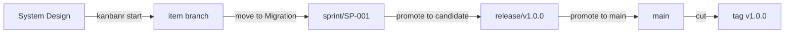

# TOGAF, sprints and releases from the command line

This guide takes a project from setup to a shipped release using TOGAF phases, sprints and releases,
with you running each command. To work by talking to Claude instead, see
[TOGAF with Claude](togaf-with-claude.md).

The commands and output come from a real run on a scratch project.

## Three clocks

Three things move at their own pace, and most confusion comes from mixing them up:

| | What it answers | Moves when |
|---|---|---|
| **TOGAF phase** | How far has this item got? | Its gates are met, one item at a time |
| **Sprint** | What are we working on these two weeks? | You start and close it |
| **Release** | What has reached users? | You promote it, stage by stage |

An item can be finished in its sprint and still not released. Merging is not shipping: **an item
is released only when a release that holds it is cut.**

Here is where the phases meet the branches:



## Setting it up

In your project folder:

```text
kanbanr init shop
kanbanr config workflow --preset togaf
kanbanr config cadence --sprints on --releases on --git-model on
kanbanr git install-hooks
```

`kanbanr git model` shows what the git model will do. Nothing is pushed for you:

```text
topology:   sprints and releases
main:       main
line:       none — start a sprint to have one
branch at:  sprint/<SP>
production: at the release cut
protected:  main, sprint/*, release/*
kanbanr merges:
  - each item branch into sprint/<SP> when the item enters the integrate stage (--no-ff, naming the item)
  - release/<V> into main at the release's last stage (tagged <V>, a fast-forward)
  - sprint/<SP> into each item branch carried into that sprint (a catch-up merge; a conflict is reported for that item)
pushing:    never automatic — you review and push
```

### The charter comes first

**The gates are not enforced until the project has a charter**, and an item created before the
charter was adopted is exempt from them. Without one, moves that should be refused still succeed,
but each says what the gate would have needed and that `kanbanr charter set` turns the gates on.
So agree the charter before creating any items:

```text
kanbanr charter set --file charter.yaml
```

### Release stages

By default a release has four stages, and the cut does everything at once:

```text
STAGE          REQUIRES                           ON ENTER
candidate      —                                  branch                         default
test           —                                  —                              default
staging        —                                  —                              default
production     —                                  move_main, tag                 the cut, default
```

We recommend three stages instead, so that main has to be pushed before anything is tagged.
kanbanr can't see whether CI passed, so check that yourself before the cut:

```text
kanbanr config cadence --release-stages candidate,main,production
kanbanr config release-stage candidate --on-enter branch,prepare
kanbanr config release-stage main --requires items_finished --on-enter move_main
kanbanr config release-stage production --requires main_at_release,pushed --on-enter tag
kanbanr config release-prepare --version-file Cargo.toml --changelog CHANGELOG.md --notes "docs/releases/{version}.md"
```

```text
STAGE          REQUIRES                           ON ENTER
candidate      —                                  branch, prepare
main           items_finished                     move_main
production     main_at_release, pushed            tag                            the cut
```

The `release-prepare` line names your own files. The notes file is created for you, but the version
file must already be on the sprint's branch, or promoting to candidate is refused and nothing changes.

### Decide when an item is done for its sprint

Under the TOGAF preset only **Operations** counts as done, and items reach Operations at the cut, or
at their `release` sign-off once all their tasks are done.
So if you close a sprint before its release is cut, an item that is merged and sitting in Migration
is carried over, to the backlog by default:

```text
closed SP-001; carried FEAT-001 → backlog
```

If your sprints end before your releases do, mark Migration as done. Export the workflow, add one
line, and load it back:

```text
kanbanr config workflow --export > workflow.yaml
```

```yaml
gates:
  Migration:
    done: true
```

```text
kanbanr config workflow --from-file workflow.yaml
```

The same close then says `nothing carried over`, and the release still takes the item to Operations
when it is cut. If you always cut the release before closing the sprint, you can leave this alone.

## Planning a sprint

```text
kanbanr sprint add --start 2026-11-03 --length 2w --goal "Carts survive a return"
kanbanr sprint start SP-001
kanbanr feature add --title "Restore the cart" --milestone MS-001 --spec "# Restore the cart"
kanbanr sprint plan SP-001 FEAT-001
kanbanr release add v1.0.0
kanbanr release plan v1.0.0 FEAT-001
```

Starting the sprint makes the `sprint/SP-001` branch from main without switching your checkout.
Items in the sprint branch from it.

A sprint and a release don't have to line up. One release can take items from several sprints, and
one sprint can feed several releases.

## One item, phase by phase

Each move is refused until its gate is met, and the refusal says what's missing.

| Phase | What must be true to enter | Commands |
|---|---|---|
| **Vision** | Nothing | `kanbanr feature add` |
| **Business Arch** | Statement, goal, who, what, why, requirements, approval | `kanbanr feature define`, `kanbanr approve` |
| **System Design** | How, where, approval | `kanbanr feature define`, `kanbanr approve` |
| **Implementation** | A test named for every requirement, approval, a `## Design` section in the spec, the `design-review` sign-off | `kanbanr feature edit`, `kanbanr signoff`, `kanbanr start` |
| **Migration** | Requirements proven by green tests, docs updated, the `docs-folded` sign-off | `kanbanr test`, `kanbanr signoff`, `kanbanr move` |
| **Operations** | Green tests, the `release` sign-off | `kanbanr signoff`, which makes the move once all the item's tasks are done; otherwise the cut does |

**An edit lapses your approval.** When the definition changes, the next move says so, and you approve
the larger definition:

```text
cannot move FEAT-001 to 'System Design': approval lapsed — the definition changed after it was approved.
```

**Code starts at Implementation.** `kanbanr start` makes the item's branch from the sprint's branch,
and moves the item if its gate is met:

```text
created feat/FEAT-001-restore-the-cart from sprint/SP-001
FEAT-001 -> Implementation
```

If the gate isn't met, nothing is created: no branch is made, your checkout stays where it was and
the item stays where it is. The refusal says what is missing:

```text
error: unsupported operation: cannot move FEAT-001 to 'Implementation': the spec has no 'Design' section…
```

Once the gate is met, run `kanbanr start` again. Commit with `kanbanr commit`, which adds
`Refs: kanbanr:FEAT-001` to the commit.

**Migration is where the merge happens.** Record the test results and the docs sign-off, and the move
merges the branch into the sprint's:

```text
FEAT-001 -> Migration
merged feat/FEAT-001-restore-the-cart into sprint/SP-001 (dee5a5918fb8)
```

Your checkout stays on the item's branch, so switch back when you want the line.

**Give the `release` sign-off before promoting to main.** Promoting needs every item able to reach
Operations, and each item needs its own sign-off to get there. Without it the promotion is refused,
and nothing changes:

```text
v1.0.0 cannot go to main yet — nothing was changed:
  - items_finished (main): FEAT-001 would carry over — FEAT-001 carries over: … no sign-off 'release' — `kanbanr signoff FEAT-001 release`.
```

## Handing work to sub-agents

A scope limits what an agent working in its own worktree may do, and kanbanr enforces it. Issue one
from a branch other than the item's, which the agent needs for its worktree:

```text
kanbanr scope issue build FEAT-002 --note "task T1"
```

The agent claims the scope in its worktree. It may then record its own item's tasks and tests and
commit on its item's branch. Anything else is refused and names the boundary:

```text
refused by agent scope SC-001 (build, FEAT-002): `move feature FEAT-002` is not one of its operations.
refused by agent scope SC-001 (build, FEAT-002): `approve definition of FEAT-002` is not one of its operations.
refused by agent scope SC-001: agents never push. The coordinator reviews the branch and pushes it.
```

When the agent finishes its tasks, the item stays where it is until you review the branch and move
it. See [Sub-agents and agent scopes](../using/with-claude.md#sub-agents-and-agent-scopes).

## Releasing

Release in this order, and you won't have to go back. `kanbanr release promote v1.1.0 --plan` shows
what a promotion would do and changes nothing.

| Step | Command | What happens |
|---|---|---|
| 1. Candidate | `kanbanr release promote v1.1.0 candidate` | Makes `release/v1.1.0` from the sprint's branch, and commits the version, the changelog heading and draft notes onto it |
| 2. Write the notes | `kanbanr release notes v1.1.0 --edit` | The draft only lists requirements. Rewrite it for readers |
| 3. Run your full checks | Your project's own | Over the release |
| 4. Sign off each item | `kanbanr signoff FEAT-001 release` | If not already given |
| 5. Main | `kanbanr release promote v1.1.0 main` | Fast-forwards main to the release, without tagging |
| 6. Push main, wait for CI | `git push origin main` | |
| 7. Cut | `kanbanr release promote v1.1.0 production` | Tags main, ships the items and moves any not already there to Operations |
| 8. Push the tag | `git push origin v1.1.0` | |
| 9. Merge forward | `kanbanr git forward v1.1.0` | Brings the release's commits into the sprint's branch |

The notes and the changelog heading carry the day the candidate was prepared. Step 5 dates them
today before it moves main. If main moved before then, the cut's `--plan` warns, and
`kanbanr release redate v1.1.0` dates them today. Push main again if it says so.

The cut stays refused until main is pushed:

```text
✗ pushed (production): dee5a59 is not on origin/main — push main (`git push origin main`), then wait for CI
```

**Freeze the candidate.** Once a release is a candidate, send anything new to the next release, and
change only its notes. Reopening a candidate for each thing you find is how a release never closes.

**Promoting moves main, not your checkout.** If you're on the sprint's branch you'll stay there, and
GitHub won't change until you push.

**The notes live on the release branch**, so they aren't in your checkout. Read and change them from
the release itself:

```text
kanbanr release notes v1.1.0
kanbanr release notes v1.1.0 --edit
```

If you save notes after main has moved to the release, main moves with them, and you must push it
again:

```text
main held v1.1.0, so it moved with the notes to 0360a99: push main again and wait for CI before the cut
```

**The date follows the release.** The notes and the changelog heading are dated when the candidate is
made, and promoting to main dates them today. If main moved earlier and the cut comes later, the
cut's `--plan` warns, and `kanbanr release redate v1.1.0` dates them today. Notes can't be edited
after the cut.

## Closing the sprint

```text
kanbanr sprint close SP-002
kanbanr retro --sprint SP-002
```

Closing changes the board only. In this setup main moves at the cut, so no branch moves and no tag
is made. With no sprint running, there's no line for new items to branch from, so start the next
sprint before starting any item.

## When things go wrong

| You see | It means | Do this |
|---|---|---|
| Moves succeed that shouldn't | No charter, or the item predates it | Set the charter before creating items |
| `approval lapsed` | The definition changed after you approved it | Read the change and approve again |
| `carried FEAT-001 → backlog` at a sprint close | The item is merged, but not done for the sprint | Plan it into the next sprint, or mark Migration done |
| `FEAT-001 would carry over` at a promotion | The item can't reach Operations yet | Do what the line names, often `kanbanr signoff FEAT-001 release` |
| `does not exist on release/v1.1.0` at candidate | A file named in `release-prepare` isn't on the sprint's branch | Commit it on an item's branch and merge that first |
| A defect in a shipped release | It needs a fix on its own | See [Patch releases](../using/processes.md#patch-releases) |

A move can also go past its gate with `--override "<reason>"`, and the reason stays on the item. Save
it for real exceptions.
