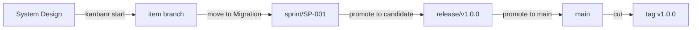

# TOGAF, sprints and releases from the command line

This guide takes a project from setup to a shipped release using TOGAF phases, sprints and releases,
with you running each command. To work by talking to Claude instead, see
[TOGAF with Claude](togaf-with-claude.md).

The commands and output come from a real run on a scratch project.

## Three clocks

Three things move at their own pace, and most confusion comes from mixing them up:

| | What it answers | Moves when |
|---|---|---|
| **TOGAF phase** | How far has this item got? | Its gates are met, one item at a time |
| **Sprint** | What are we working on these two weeks? | You start and close it |
| **Release** | What has reached users? | You promote it, stage by stage |

An item can be finished in its sprint and still not released. Merging is not shipping: **an item
is released only when a release that holds it is cut.**

Here is where the phases meet the branches:



## Setting it up

In your project folder:

```text
kanbanr init shop
kanbanr config workflow --preset togaf
kanbanr config cadence --sprints on --releases on --git-model on
kanbanr git install-hooks
```

`kanbanr git model` shows what the git model will do. Nothing is pushed for you:

```text
topology:   sprints and releases
main:       main
line:       none — start a sprint to have one
branch at:  sprint/<SP>
production: at the release cut
protected:  main, sprint/*, release/*
kanbanr merges:
  - each item branch into sprint/<SP> when the item enters the integrate stage (--no-ff, naming the item)
  - release/<V> into main at the release's last stage (tagged <V>, a fast-forward)
  - sprint/<SP> into each item branch carried into that sprint (a catch-up merge; a conflict is reported for that item)
pushing:    never automatic — you review and push
```

### The charter comes first

**The gates are not enforced until the project has a charter**, and an item created before the
charter was adopted is exempt from them. Without one, moves that should be refused still succeed,
but each says what the gate would have needed and that `kanbanr charter set` turns the gates on.
So agree the charter before creating any items:

```text
kanbanr charter set --file charter.yaml
```

### Release stages

A project that turns releases on gets three stages, `candidate`, `main` and `tag`, with the gates
below written into the board's config, so you can see and edit them. Main has to be pushed
before anything is tagged. Candidate waits for `items_merged`, so the release branch is made only once the items are
merged; the commands below set the same thing. kanbanr can't see whether CI passed. Look at it yourself, then record what it said:
`kanbanr gate record ci --passed --url <link to the run>`. Say the project has CI with
`kanbanr config cadence --has-ci on` and the `tag` stage requires that result
(`gate_passed`, with `ci` as the commit gate); without the flag it requires only `main_at_release`
and `pushed`.

A board made before 0.6 that has releases on and names no stages keeps the four it had, `candidate`,
`test`, `staging` and `production`. `test` and `staging` do nothing, and kanbanr says so when you
configure them and in `kanbanr release stages`. To move such a board to the three, run
`kanbanr config cadence --release-stages candidate,main,tag`, then the `release-stage` lines below.
Stages you add after `tag` follow the cut and are confirmed by you.

```text
kanbanr config cadence --release-stages candidate,main,tag
kanbanr config release-stage candidate --requires items_merged --on-enter branch,prepare
kanbanr config release-stage main --requires items_finished --on-enter move_main
kanbanr config release-stage tag --requires main_at_release,pushed --on-enter tag
kanbanr config release-prepare --version-file Cargo.toml --changelog CHANGELOG.md --notes "docs/releases/{version}.md"
```

```text
STAGE          REQUIRES                           ON ENTER
candidate      items_merged                       branch, prepare
main           items_finished                     move_main
tag            main_at_release, pushed            tag                            the cut
```

To stop a release being promoted while work is still going on, have the candidate stage require
`items_merged`: every item planned into the release must be at the integrate stage or later (for
TOGAF, Migration), and the plan names each item that is not, with the status it is at. And to stop a
named promotion jumping over a stage, list it in `--after`: kanbanr then refuses to enter the stage
until the release has been promoted into the one named. For example, with a `ci` stage you record
yourself:

```text
kanbanr config cadence --release-stages candidate,main,ci,tag
kanbanr config release-stage tag --after ci
```

kanbanr records that the stage was entered, not that CI passed. To require a recorded CI result as
well, use `gate_passed`.

The `release-prepare` line names your own files. The notes file is created for you, but the version
file must already be on the sprint's branch, or promoting to candidate is refused and nothing changes.


#### Stages after the tag

The stage that tags is the cut, but it does not have to be the last. Add stages after it, for the
places you run the release before it counts as out, and each becomes a confirmation you give:

```text
kanbanr config cadence --release-stages candidate,main,tag,staging,production
kanbanr config release-stage tag --on-enter tag
kanbanr config commit-gates ci
```

Promoting to `tag` tags the commit and ships nothing. The Releases page then shows the result you
recorded for the tag and asks for the next stage only after a passed one. Each stage after the
tag, `staging` and `production` here, is confirmed with
`kanbanr release promote <VERSION> --note "what you checked"`. Confirming the last stage ships the
release: the items reach their last status and the notes are written. If your CI fails on the tag,
record the failed result and run `kanbanr release add <NEW VERSION> --patch-of <VERSION>
--from-failed-tag --link <run> --notes "what you saw"`: it files a defect with the link and your
notes, plans it and the release's items into a patch branched from the tag, and marks the failed
release as superseded. The tag stays in git.

### Closing a sprint before its release

Under the TOGAF preset Migration counts as done for a sprint, and Operations is when a release ships
the item. So closing a sprint before its release is cut carries over only work that has not merged,
to the backlog by default. An item still at Implementation is carried:

```text
closed SP-001; carried FEAT-001 → backlog
```

## Planning a sprint

Setup creates no sprint or release; make them when you are ready. A sprint can be changed until it
starts (`kanbanr sprint edit SP-001 --goal "…" --start 2026-11-10`), and an empty sprint or release
made by mistake is removed with `kanbanr sprint remove SP-001` or `kanbanr release remove v1.0.0`.

```text
kanbanr sprint add --start 2026-11-03 --length 2w --goal "Carts survive a return"
# or start it today: kanbanr sprint add --start today --length 2w --goal "…"
kanbanr sprint start SP-001
kanbanr feature add --title "Restore the cart" --milestone MS-001 --spec "# Restore the cart"
kanbanr sprint plan SP-001 FEAT-001
kanbanr sprint unplan FEAT-001                 # take it back out
kanbanr release add v1.0.0
kanbanr release plan v1.0.0 FEAT-001
```

Starting the sprint makes the `sprint/SP-001` branch from main without switching your checkout.
Items in the sprint branch from it.

When a sprint is running, plan each release item into it too. `kanbanr release plan` does not do it
for you; it names the items it planned that are in no sprint, and the command that plans them in:

```text
FEAT-002 is in no sprint and SP-001 is running: kanbanr sprint plan SP-001 FEAT-002
```

`kanbanr doctor` names any item planned into a release but into no sprint while a sprint runs.

A sprint and a release don't have to line up. One release can take items from several sprints, and
one sprint can feed several releases.

## One item, phase by phase

Each move is refused until its gate is met, and the refusal says what's missing.

| Phase | What must be true to enter | Commands |
|---|---|---|
| **Vision** | Nothing | `kanbanr feature add` |
| **Business Arch** | Statement, goal, who, what, why, requirements, approval | `kanbanr feature define`, `kanbanr approve` |
| **System Design** | How, where, approval | `kanbanr feature define`, `kanbanr approve` |
| **Implementation** | A test named for every requirement, approval, a `## Design` section in the spec, the `design-review` sign-off | `kanbanr feature edit`, `kanbanr signoff`, `kanbanr start` |
| **Migration** | Requirements proven by green tests, docs updated, the `docs-folded` sign-off (offered once the item's documents are built; `kanbanr check` names any that are not; the Review page lists texts that name what the item changed, and `kanbanr drift` lists them for the board) | `kanbanr test`, `kanbanr signoff`, `kanbanr move` |
| **Operations** | Green tests, the `release` sign-off | `kanbanr signoff` records the sign-off; the cut makes the move |

**Adding keeps your approval; changing lapses it.** Text added to the definition is reviewed at the
next decision, such as `kanbanr signoff FEAT-001 design-review`. When approved text is changed or
removed, the next move says so, and you approve again:

```text
cannot move FEAT-001 to 'System Design': approval lapsed — the definition changed after it was approved.
```

**A verdict records where it was taken.** Each approval, ratification, sign-off and decision notes
whether it came from the monitor, from a command inside a Claude Code session (`conversation`), or
from your terminal. `kanbanr feature show` ends each line with it, and `--json` carries `origin`; an
item from before 0.6.0 reads origin unknown. Repeating a verdict on text that hasn't changed records
nothing and prints `already approved by Ada on 2026-11-07 12:26:00 from the monitor; nothing
recorded`. A sign-off repeated with a new note or doc is recorded.

**A changed spec comes back for sign-off.** A `design-review` sign-off covers the whole spec as it
was when you gave it. If the spec changes afterwards, even outside `## Design`, the sign-off reads
"changed since sign-off", and `kanbanr review --pending` lists the item as `spec_changed` with the
changed lines. Sign again with `kanbanr signoff FEAT-001 design-review`. Pass `--spec-rev` with the
`spec_rev` the queue gave to refuse the sign-off if the spec moved on since you read it.

**Code starts at Implementation.** `kanbanr start` makes the item's branch from the sprint's branch,
and moves the item if its gate is met:

```text
created feat/FEAT-001-restore-the-cart from sprint/SP-001
FEAT-001 -> Implementation
```

If the gate isn't met, nothing is created: no branch is made, your checkout stays where it was and
the item stays where it is. The refusal says what is missing:

```text
error: unsupported operation: cannot move FEAT-001 to 'Implementation': the spec has no 'Design' section…
```

Once the gate is met, run `kanbanr start` again. Commit with `kanbanr commit`, which adds
`Refs: kanbanr:FEAT-001` to the commit.

**Migration is where the merge happens.** Record the test results and the docs sign-off, and the move
merges the branch into the sprint's:

```text
FEAT-001 -> Migration
merged feat/FEAT-001-restore-the-cart into sprint/SP-001 (dee5a5918fb8)
```

Your checkout stays on the item's branch, so switch back when you want the line.

**Give the `release` sign-off before promoting to main.** Promoting needs every item able to reach
Operations, and each item needs its own sign-off to get there. Without it the promotion is refused,
and nothing changes. A promotion to the cut or to the last stage is held the same way, as
`merged_items_ship`, for an item whose code is already merged but which would be carried over; it
names the item and what it lacks, and work that isn't done or isn't merged is still carried:

```text
v1.0.0 cannot go to main yet — nothing was changed:
  - items_finished (main): FEAT-001 would carry over — FEAT-001 carries over: … no sign-off 'release' — `kanbanr signoff FEAT-001 release`.
```

### Chores

A process can give a kind its own path. The built-in `togaf` process gives `chore` the path
Vision → Implementation → Migration → Operations, skipping Business Arch and System Design. `kanbanr process show togaf` lists each kind's path under
"Lighter paths".

```bash
kanbanr feature add --title "Pin the CI image" --milestone MS-001 --kind chore
```

A chore's first move off Vision asks the path's own conditions (`statement`, `goals`,
`requirements`, and `ears` where the path lists it) as well as the entered stage's gate, so it still
records why it exists and how it is verified. A move to a phase off the path is refused, and the
message names the path. `approved` and the `release` sign-off stay in force; the `design` and `design-review` parts do not apply. An item whose kind is changed to `chore` while it's at a
phase off the path keeps the ordinary transitions, so it is never stranded.

## Handing work to sub-agents

A scope limits what an agent working in its own worktree may do, and kanbanr enforces it. Issue one
from a branch other than the item's, which the agent needs for its worktree:

```text
kanbanr scope issue build FEAT-002 --note "task T1"
```

The agent claims the scope in its worktree. It may then record its own item's tasks and tests and
commit on its item's branch. Anything else is refused and names the boundary:

```text
refused by agent scope SC-001 (build, FEAT-002): `move feature FEAT-002` is not one of its operations.
refused by agent scope SC-001 (build, FEAT-002): `approve definition of FEAT-002` is not one of its operations.
refused by agent scope SC-001: agents never push. The coordinator reviews the branch and pushes it.
```

When the agent finishes its tasks, the item stays where it is until you review the branch and move
it. See [Sub-agents and agent scopes](../using/with-claude.md#sub-agents-and-agent-scopes).

Stay in the project folder. Never `cd` into an agent's worktree: look inside with `git -C <path>`,
`make -C <path>`, `npm --prefix <path>` or a subshell `(cd <path> && …)`. If your shell is already
there, `cd` back to the project folder. Revoking a scope (`kanbanr scope revoke SC-…`) stops the
agent on its next tool call and never restricts you.

## Releasing

**Before your first release, design the pipeline.** A release workflow can only be tested by running
it, a tag can't be moved once it's pushed, and shipped notes can't be edited, so a mistake in the
pipeline costs a whole version number. Settle the stages, the checks, the release description and a run without a tag first:
see [Designing CI and the release workflow](delivery-pipeline.md).

Release in this order, and you won't have to go back. `kanbanr release promote v1.1.0 --plan` shows
what a promotion would do and changes nothing.

| Step | Command | What happens |
|---|---|---|
| 1. Candidate | `kanbanr release promote v1.1.0 candidate` | Makes `release/v1.1.0` from the sprint's branch, and commits the version, the changelog heading and draft notes onto it |
| 2. Write the notes | `kanbanr release notes v1.1.0 --edit` | The draft only lists requirements. Rewrite it for readers |
| 3. Run your full checks | Your project's own | Over the release |
| 4. Sign off each item | `kanbanr signoff FEAT-001 release` | If not already given |
| 5. Main | `kanbanr release promote v1.1.0 main` | Fast-forwards main to the release, without tagging |
| 6. Push main | `git push origin main` | |
| 7. Wait for CI, then record it | `kanbanr gate record ci --passed --url <link to the run>` | Once CI on main is green. The cut waits for it |
| 8. Cut | `kanbanr release promote v1.1.0 tag` | Tags main, ships the items and moves any not already there to Operations |
| 9. Push the tag | `git push origin v1.1.0` | |
| 10. Merge forward | `kanbanr git forward v1.1.0` | Brings the release's commits into the sprint's branch |

The notes and the changelog heading carry the day the candidate was prepared. Step 5 dates them
today before it moves main. If main moved before then, the cut's `--plan` warns, and
`kanbanr release redate v1.1.0` dates them today. Push main again if it says so.

The cut stays refused until main is pushed:

```text
✗ pushed (tag): dee5a59 is not on origin/main — push main (`git push origin main`), then wait for CI
```

**Freeze the candidate.** Once a release is a candidate, send anything new to the next release, and
change only its notes. Reopening a candidate for each thing you find is how a release never closes.

**Promoting moves main, not your checkout.** If you're on the sprint's branch you'll stay there, and
your remote server won't change until you push.

**The notes live on the release branch**, so they aren't in your checkout. Read and change them from
the release itself:

```text
kanbanr release notes v1.1.0
kanbanr release notes v1.1.0 --edit
```

They are read from the path they were written to, so changing `kanbanr config release-prepare
--notes` later leaves earlier releases' notes readable.

If you save notes after main has moved to the release, main moves with them, and you must push it
again:

```text
main held v1.1.0, so it moved with the notes to 0360a99: push main again and wait for CI before the cut
```

**The date follows the release.** The notes and the changelog heading are dated when the candidate is
made, and promoting to main dates them today. If main moved earlier and the cut comes later, the
cut's `--plan` warns, and `kanbanr release redate v1.1.0` dates them today. Notes can't be edited
after the cut.

**A merge into a promoted release sends it back.** `kanbanr move` of an item into a release that is
past candidate and not cut returns the release to its first stage and says so:

```text
v1.1.0 was at main; FEAT-002 is merged into it, so it is back at candidate. From here: Update the release notes, then Run the release gate again for the new tip and record the result, then Promote to main, then Push main and wait for CI, then Cut v1.1.0
```

`kanbanr release promote v1.1.0 --plan` and `kanbanr release stages` begin with "Sent back by
FEAT-002". Do the steps in order:

1. `kanbanr release notes v1.1.0 --edit`; the notes end with "Not mentioned yet: FEAT-002" until they
   name each item planned into the release.
2. Run your full checks over the release, then `kanbanr gate record ci --passed --commit <sha>`. A
   pass recorded for an earlier commit stands when only documentation changed since; the plan names
   the commit. `kanbanr config gate-docs` sets which paths count as documentation (`docs/` and `*.md`
   by default).
3. `kanbanr release promote v1.1.0 main`
4. `git push origin main`, then wait for CI.
5. `kanbanr release promote v1.1.0 tag`, which is refused until main is at the release tip, pushed,
   and the gate has passed where the project names commit gates.

Saving notes does not send a release back. A release that is tagged and not shipped refuses the
move before anything is merged, naming the tag; the change needs `kanbanr release patch v1.1.0`.

## Closing the sprint

```text
kanbanr sprint close SP-002
kanbanr retro --sprint SP-002
```

Closing changes the board only. In this setup main moves at the cut, so no branch moves and no tag
is made. With no sprint running, there's no line for new items to branch from, so start the next
sprint before starting any item.

## When things go wrong

| You see | It means | Do this |
|---|---|---|
| Moves succeed that shouldn't | No charter, or the item predates it | Set the charter before creating items |
| `approval lapsed` | The definition changed after you approved it | Read the change and approve again |
| `carried FEAT-001 → backlog` at a sprint close | The item is merged, but not done for the sprint | Plan it into the next sprint, or mark Migration done |
| `FEAT-001 would carry over` at a promotion | The item can't reach Operations yet | Do what the line names, often `kanbanr signoff FEAT-001 release` |
| An item stays in Migration after the cut | The release shipped but the item never got what it lacked | `kanbanr doctor` names it; give the sign-off it lacks (`kanbanr check FEAT-001`), or plan it into a coming release with `kanbanr release plan` |
| A release is back at candidate after a move | An item was merged into it after it left candidate | Do the steps `kanbanr release promote <V> --plan` lists |
| `v1.1.0 is tagged at …` on a move | The release is tagged and waits for its later stages | `kanbanr release patch v1.1.0`, and plan the change into the patch |
| `does not exist on release/v1.1.0` at candidate | A file named in `release-prepare` isn't on the sprint's branch | Commit it on an item's branch and merge that first |
| A defect in a shipped release | It needs a fix on its own | See [Patch releases](../using/processes.md#patch-releases) |

A move can also go past its gate with `--override "<reason>"`, and the reason stays on the item. Save
it for real exceptions.
