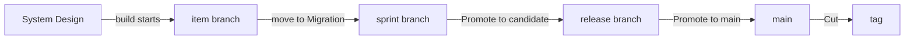

# TOGAF, sprints and releases with Claude

This guide takes a project from setup to a shipped release using TOGAF phases, sprints and releases.
You don't need to learn any commands:

- **You talk to Claude** for everything except decisions and pushes. Use your own words. The ones
  here are only examples.
- **You decide on the monitor:** approvals and sign-offs on the **Review** page, promotions and the
  cut on the **Releases** page.
- **You push from your terminal.** Nothing reaches GitHub until you do.

Prefer to run the commands yourself? See [TOGAF from the command line](togaf-cli.md).

## Three clocks

Three things move at their own pace, and most confusion comes from mixing them up:

| | What it answers | Moves when |
|---|---|---|
| **TOGAF phase** | How far has this item got? | Its gates are met, one item at a time |
| **Sprint** | What are we working on these two weeks? | You ask Claude to start or close it |
| **Release** | What has reached users? | You promote it on the Releases page |

An item can be finished in its sprint and still not released. Merging is not shipping: **an item is
released only when a release that holds it is cut.**

## Setting it up

> Start using kanbanr for this project. Use TOGAF, with sprints and releases.

Claude asks where the board should live and what the project is for. It then writes a plan showing
the process, the branches it will use and where each one merges. **Accepting the plan applies it.**

Ask for the things that make the rest of this guide work:

> Agree a charter with me first, then set up release stages so that main is pushed and CI has seen it
> before anything is tagged.

**Do the charter first.** Gates aren't enforced until a project has one, and items created before it
are exempt. Claude asks for the project's purpose and goals. Every item then links to a goal.

> Open the monitor, with writes on.

Keep it open. Claude gives you the address, and every decision below happens there.

**Decide when an item is done for its sprint.** Under TOGAF only Operations counts as done, and items
reach Operations when a release is cut. So closing a sprint before its release sends merged items
back to the backlog. If your sprints end before your releases do, say so:

> Our sprints often end before the release. Count Migration as done for a sprint.

## Planning a sprint

> Start a two-week sprint for carts surviving a return. Put the cart restore in it, for release 1.0.

Claude creates the sprint and its branch, adds the item and plans it into the sprint and the release.
Your checkout doesn't move.

A sprint and a release don't have to line up. One release can take items from several sprints.

## One item, phase by phase

Ask for the work in your own words, and Claude asks only what it can't work out. Each phase has a
gate. When something's missing, Claude either drafts it or brings it to you.

> We need saved carts: shoppers should be able to come back to their basket. Take it to Business Arch.

| Phase | What Claude does | What you do on the Review page |
|---|---|---|
| **Vision** | Writes what it is and why | Nothing yet |
| **Business Arch** | Drafts who, what, why and the requirements | **Approve** |
| **System Design** | Proposes how and where, and checks that against the requirements | **Approve** again, because the definition grew |
| **Implementation** | Writes the design and its task list, and names a test for each requirement | **Sign off design-review** |
| **Migration** | Builds on the item's branch, runs the tests and updates the docs | **Sign off docs-folded** |
| **Operations** | Nothing: the cut moves it here | **Sign off release** |

**Approve first, then sign off.** An item with both waiting shows **Approve**, then **Sign off** once
you've approved it, so check back after approving.

**You'll approve more than once, and that's deliberate.** Each approval covers exactly the text you
saw. If the definition changes, your approval lapses and the item returns to the Review page. Read
what changed, then approve again.

**Just ask to move it on:**

> Move the cart restore on to System Design.

If something's missing, Claude tells you what and either fixes it or asks you. Nothing moves past a
gate unless you say why, and that reason stays on the item.

**Moving to Migration is the merge.** kanbanr merges the item's branch into the sprint's branch. It
isn't released yet.

## Handing work to sub-agents

> Have a sub-agent build these tasks.

Claude gives each agent a scope, which kanbanr enforces, so you don't have to rely on the agent's
brief. An agent can record its own tasks and test results and commit on its own branch. It can't
move items, approve anything or push.

You'll see its progress on the item's page as it works, and its scope on the **Workflow** page. When
it finishes, Claude reviews the branch and brings you any decisions.

## Releasing

Follow this order and you won't have to go back:

| Step | Who | Do this |
|---|---|---|
| 1 | You | **Releases** page: **Promote to candidate**. This makes the release branch and drafts the version, changelog and notes |
| 2 | Claude | Say "Write the release notes for readers", because the draft only lists requirements |
| 3 | You | Open **Release notes** on the release, then **Edit notes** and **Save** for any changes |
| 4 | Claude | Say "Run the full checks over the release" |
| 5 | You | **Review** page: **Sign off release** on each item, if you haven't already |
| 6 | You | **Releases** page: **Promote to main**. This moves main to the release, without tagging |
| 7 | You | Terminal: `git push origin main`, then wait for CI to go green |
| 8 | You | **Releases** page: **Check again**, then **Cut v1.0.0**. This tags main and moves the items to Operations |
| 9 | You | Terminal: `git push origin v1.0.0`, then wait for the release workflow |
| 10 | Claude | Say "The release is out. Bring it forward into the sprint" |

**Each button says what it will do**, and stays greyed out with the reason until it's ready. If it
says an item would carry over, that item usually needs its **Sign off release**.

**Freeze the candidate.** Once a release is a candidate, tell Claude to send anything new to the next
release, and change only the notes. Reopening a candidate for each thing you find is how a release
never closes.

**Promoting moves main, not your checkout.** You may still be on the sprint's branch, and GitHub won't
change until you push.

**If you save notes after promoting to main,** main moves with them. The page tells you to push main
again and wait for CI before the cut.

**Check the date before you cut.** The notes and changelog are dated when the candidate is made. If
the cut comes later, ask Claude to correct them first, because shipped notes can't be edited.

## Closing the sprint

> Close the sprint and do a retro.

Claude closes it, shows what carried over, and writes the retro with you. This changes only the
board: no branch moves and nothing is tagged. Start the next sprint before starting new items,
because new items branch from the running sprint.

## Who does what

| | You | Claude |
|---|---|---|
| **Definitions** | Answer what only you know, then **Approve** | Draft them, ask, and keep the spec current |
| **Design** | **Sign off design-review** | Write the design and its task list |
| **Code and tests** | Review what you want to | Build, or give the work to sub-agents, and record results |
| **Merging an item** | **Sign off docs-folded** | Update the docs and move the item |
| **Sprints** | Say what goes in and when it closes | Create, plan and close them |
| **Releases** | Each **Promote**, each **Sign off release**, and the **Cut** | Write the notes, run the checks, bring it forward |
| **GitHub** | **Every push** of code and tags, and the board | Nothing |

## When things go wrong

| You see | It means | Do this |
|---|---|---|
| Moves go through that shouldn't | No charter, or the item is older than it | Ask Claude to agree a charter before creating items |
| An item is back on the Review page | Its definition changed after you approved it | Read the change, then **Approve** again |
| An item goes to the backlog when a sprint closes | It's merged but not done for that sprint | Ask Claude to plan it into the next sprint, or count Migration as done |
| A promotion says an item would carry over | It can't reach Operations yet | Do what the page says, usually **Sign off release** |
| **Cut** stays greyed out after you pushed | The page hasn't read the push yet | **Check again** |
| A defect in a shipped release | It needs its own fix | Ask Claude for a patch release, and see [Patch releases](../using/processes.md#patch-releases) |

## What Claude runs

You never need these, but here they are if you're curious, or if you want to check what Claude did.
[TOGAF from the command line](togaf-cli.md) covers them step by step.

| You asked for | Claude runs |
|---|---|
| Set up the process | `kanbanr config workflow --preset togaf` |
| Sprints, releases and branches | `kanbanr config cadence --sprints on --releases on --git-model on` |
| A sprint | `kanbanr sprint add`, `kanbanr sprint start`, `kanbanr sprint plan` |
| A release | `kanbanr release add`, `kanbanr release plan` |
| Moving an item | `kanbanr move` |
| Starting the build | `kanbanr start` |
| A sub-agent | `kanbanr scope issue` |
| Release notes | `kanbanr release notes` |
| Bringing a release forward | `kanbanr git forward` |
| Closing a sprint | `kanbanr sprint close`, `kanbanr retro` |
