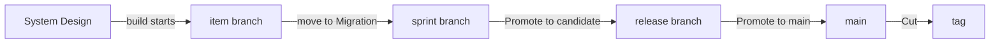

# TOGAF, sprints and releases with Claude

This guide takes a project from setup to a shipped release using TOGAF phases, sprints and releases.
You don't need to learn any commands:

- **You talk to Claude** for everything except decisions and pushes. Use your own words. The ones
  here are only examples.
- **You decide on the monitor:** approvals and sign-offs on the **Review** page, promotions and the
  cut on the **Releases** page.
  Claude tells you what is waiting there and links to it. It never records a decision, and it
  doesn't ask for one in a plan or a question.
- **You push from your terminal.** Nothing reaches your remote server until you do.

Prefer to run the commands yourself? See [TOGAF from the command line](togaf-cli.md).

## Three clocks

Three things move at their own pace, and most confusion comes from mixing them up:

| | What it answers | Moves when |
|---|---|---|
| **TOGAF phase** | How far has this item got? | Its gates are met, one item at a time |
| **Sprint** | What are we working on these two weeks? | You ask Claude to start or close it |
| **Release** | What has reached users? | You promote it on the Releases page |

An item can be finished in its sprint and still not released. Merging is not shipping: **an item is
released only when a release that holds it is cut.**

## Setting it up

> Start using kanbanr for this project. Use TOGAF, with sprints and releases.

Claude asks where the board should live and what the project is for. It then writes a plan showing
the process, the branches it will use and where each one merges. **Accepting the plan applies it.**

Ask for the things that make the rest of this guide work:

> Agree a charter with me first, then set up release stages so that main has to be pushed before
> anything is tagged.

**Do the charter first.** Gates aren't enforced until a project has one, and items created before it
are exempt. Without one, a move that a gate would have refused still goes through, with a warning
saying what was missing. Claude asks for the project's purpose and goals. Every item then links to a goal.

**Releases can have stages after the tag.** The tag only says which commit the release is. Stages
after it, such as staging or production, are for you to confirm once you have seen the release
work there. The release ships, and its items reach their last status, when you confirm the last
one. If CI fails on the tag, record the failed result and choose **Start a patch release**: Claude
files the defect with the run's link and your notes, and the failed release is marked superseded.
Claude tells you where the release is and never confirms a stage for you.

**You record CI's verdict.** kanbanr can see that main was pushed, but it never asks a server whether
CI passed. You look at CI yourself, then record what it said on the **Releases** page (**Record
result**, with a link to the run if you like). A release stage can require that result before the
cut. Claude tells you when it is missing and never records it for you.

**The stages are candidate, main and tag.** A project that turns releases on gets these three, each
doing something: candidate prepares the release, main moves main once the items are finished, and tag
cuts the release once main is pushed. If you have CI, say so and the tag waits for your recorded
result. Ask for other stages only if you have a pipeline behind them. Releases on a board made before
this keep the four they had, `test` and `staging` among them. Those two do nothing, and Claude says so
when you configure them.
Those two record that a release passed a point and do nothing else: nothing builds or deploys when
you promote to them. Add them when you have a pipeline and environments behind them.

> Open the monitor, with writes on.

Keep it open. Claude gives you the address, and every decision below happens there.

**Decide when an item is done for its sprint.** Under TOGAF only Operations counts as done, and items
reach Operations when a release is cut. So closing a sprint before its release sends merged items
back to the backlog. If your sprints end before your releases do, say so:

> Our sprints often end before the release. Count Migration as done for a sprint.

## Planning a sprint

Setup offers to create a first sprint and a first release. Use them rather than asking for new ones,
because a sprint can be closed but not edited or deleted, so settle its dates and goal during setup.

> Start the first sprint. We need saved carts: shoppers should be able to come back to their basket.
> Put that in the sprint, for the first release.

Claude starts the sprint and creates its branch, creates the item at Vision, and plans it into the
sprint and the release. Your checkout doesn't move.

**Keep 1.0 for something people can use.** Name your first release v0.1.0 unless it really is ready
for them.

A sprint and a release don't have to line up. One release can take items from several sprints.

## One item, phase by phase

Ask for the work in your own words, and Claude asks only what it can't work out. Each phase has a
gate. When something's missing, Claude either drafts it or brings it to you.

> Take saved carts to Business Arch.

| Phase | What Claude does | What you do on the Review page |
|---|---|---|
| **Vision** | Writes what it is and why | Nothing yet. The page may offer **Approve**, but it isn't needed here and lapses when the definition grows |
| **Business Arch** | Drafts who, what, why and the requirements | **Approve** |
| **System Design** | Proposes how and where, and checks that against the requirements | **Approve** again, because the definition grew |
| **Implementation** | Writes the design and its task list, and names a test for each requirement | **Approve** again, then **Sign off design-review** |
| **Migration** | Builds on the item's branch, runs the tests and updates the docs | **Sign off docs-folded**, which appears once the docs are updated |
| **Operations** | Nothing: the cut moves it here | **Sign off release** |

**Approve first, then sign off.** An item with both waiting shows **Approve**, then **Sign off** once
you've approved it, so check back after approving.

**You'll approve more than once, and that's deliberate.** Each approval covers exactly the text you
saw. If the definition changes, your approval lapses and the item returns to the Review page. Read
what changed, then approve again.

**You decide on the Review page.** Claude tells you what's waiting there and links to it, and never records a decision for you. kanbanr refuses if it tries. If the monitor isn't running, Claude offers to start it.

**A design can bring decisions with it.** Claude drafts each one as a decision record, and you use
**Accept** or **Reject** on the Review page.

**A sign-off doesn't lapse when the design changes.** Changing the design in the item's spec leaves
**design-review** standing, so ask Claude to bring you any corrections it makes during the build.

**Operations means shipped.** **Sign off release** records your sign-off and leaves the item where it
is. The item moves to Operations when the release it is planned into is cut. The **Releases** page
tells you what has shipped.

**Just ask to move it on:**

> Move saved carts on to System Design.

If something's missing, Claude tells you what and either fixes it or asks you. Nothing moves past a
gate unless you say why, and that reason stays on the item.

**Moving to Migration is the merge.** kanbanr merges the item's branch into the sprint's branch. It
isn't released yet.

## Handing work to sub-agents

> Have a sub-agent build these tasks.

Claude gives each agent a scope, which kanbanr enforces, so you don't have to rely on the agent's
brief. An agent can record its own tasks and test results and commit on its own branch. It can't
move items, approve anything or push.

You'll see its progress on the item's page as it works, and its scope on the **Workflow** page. When
it finishes, Claude reviews the branch and brings you any decisions.

## Releasing

Start once every item in the release has reached Migration. **Promote to candidate** is offered once
every item in the release has reached Migration, and the Releases page lists any that has not.

Follow this order and you won't have to go back:

| Step | Who | Do this |
|---|---|---|
| 1 | You | **Releases** page: **Promote to candidate**. This makes the release branch and drafts the version, changelog and notes |
| 2 | Claude | Say "Write the release notes for readers", because the draft only lists requirements |
| 3 | You | Open **Release notes** on the release, then **Edit notes** and **Save** for any changes |
| 4 | Claude | Say "Run the full checks over the release" |
| 5 | You | **Review** page: **Sign off release** on each item, if you haven't already |
| 6 | You | **Releases** page: **Promote to main**. This moves main to the release, without tagging |
| 7 | You | Terminal: `git push origin main`, then wait for CI to go green |
| 8 | You | **Releases** page: **Check again**, then, with CI green, **Cut v0.1.0**. This tags main. If your stages continue after the tag, the page shows the result you recorded for it; when it is green, **Confirm** each later stage with a note of what you checked. Confirming the last one moves any item not already there to Operations |
| 9 | You | Terminal: `git push origin v0.1.0`, then wait for the release workflow |
| 10 | Claude | Say "The release is out. Bring it forward into the sprint" |

**The release date is today's.** Moving main dates the notes and changelog with the day it happens.
If the Releases page warns that they carry an earlier date, say "Date the release today", and push
main again if Claude says to.

**Each button says what it will do**, and stays greyed out with the reason until it's ready. If it
says an item would carry over, that item usually needs its **Sign off release**.

**Freeze the candidate.** Once a release is a candidate, tell Claude to send anything new to the next
release, and change only the notes. Reopening a candidate for each thing you find is how a release
never closes.

**Promoting moves main, not your checkout.** You may still be on the sprint's branch, and your remote
server won't change until you push.

**If you save notes after promoting to main,** main moves with them. The page tells you to push main
again and wait for CI before the cut.

**The date follows the release.** Promoting to main dates the notes and changelog today. If main moved
earlier and the cut comes later, the page warns you: ask Claude to re-date them before you cut,
because shipped notes can't be edited.

## Closing the sprint

> Close the sprint and do a retro.

Claude closes it, shows what carried over, and writes the retro with you. This changes only the
board: no branch moves and nothing is tagged. Start the next sprint before starting new items,
because new items branch from the running sprint.

## Who does what

| | You | Claude |
|---|---|---|
| **Definitions** | Answer what only you know, then **Approve** | Draft them, ask, and keep the spec current |
| **Design** | **Sign off design-review**, and **Accept** or **Reject** each decision | Write the design, its decisions and its task list |
| **Code and tests** | Review what you want to | Build, or give the work to sub-agents, and record results |
| **Merging an item** | **Sign off docs-folded** | Update the docs and move the item |
| **Sprints** | Say what goes in and when it closes | Create, plan and close them |
| **Releases** | Each **Promote**, each **Sign off release**, and the **Cut** | Write the notes, run the checks, bring it forward |
| **Remote server** | **Every push** of code and tags, and the board | Nothing |

## When things go wrong

| You see | It means | Do this |
|---|---|---|
| Moves go through that shouldn't | No charter, or the item is older than it | Ask Claude to agree a charter before creating items |
| An item is back on the Review page | Its definition changed after you approved it | Read the change, then **Approve** again |
| An item says it's waiting for a sign-off, but the Review page has nothing | A sign-off appears once the stage's other requirements are met | Ask Claude what's left. It's often the docs |
| An item goes to the backlog when a sprint closes | It's merged but not done for that sprint | Ask Claude to plan it into the next sprint, or count Migration as done |
| A promotion says an item would carry over | It can't reach Operations yet | Do what the page says, usually **Sign off release**; the cut then moves it |
| **Cut** stays greyed out after you pushed | The page hasn't read the push yet | **Check again** |
| Your remote server rejects your first push, naming a permission | Your sign-in can't change some files yet, often your CI's own files | Ask Claude what the message means, then grant it and push again |
| A defect in a shipped release | It needs its own fix | Ask Claude for a patch release, and see [Patch releases](../using/processes.md#patch-releases) |

## What Claude runs

You never need these, but here they are if you're curious, or if you want to check what Claude did.
[TOGAF from the command line](togaf-cli.md) covers them step by step.

| You asked for | Claude runs |
|---|---|
| Set up the process | `kanbanr config workflow --preset togaf` |
| Sprints, releases and branches | `kanbanr config cadence --sprints on --releases on --git-model on` |
| Release stages | `kanbanr config cadence --release-stages`, `kanbanr config release-stage` |
| A sprint | `kanbanr sprint add`, `kanbanr sprint start`, `kanbanr sprint plan` |
| A release | `kanbanr release add`, `kanbanr release plan` |
| Moving an item | `kanbanr move` |
| Starting the build | `kanbanr start` |
| A sub-agent | `kanbanr scope issue` |
| Release notes | `kanbanr release notes` |
| Bringing a release forward | `kanbanr git forward` |
| Closing a sprint | `kanbanr sprint close`, `kanbanr retro` |
